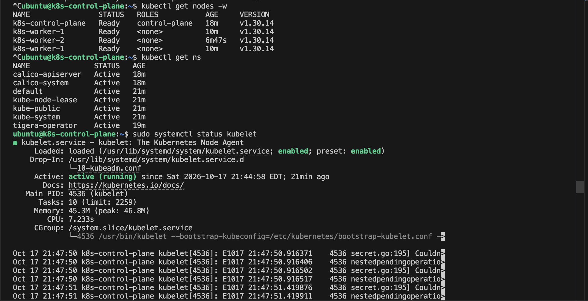

# Day 03: Bootstrapping a Multi-Node Kubernetes Cluster with Kubeadm

## What is Kubeadm?
`kubeadm` is the official Kubernetes tool for bootstrapping production-grade clusters. It automates many complex tasks such as:
- Certificate generation
- API Server deployment
- Scheduler deployment
- Controller Manager deployment
- `etcd` deployment
- `kubelet` configuration
- Node authentication

Instead of manually configuring dozens of components, `kubeadm` creates a functional cluster with just a few commands.

---

## Cluster Initialization Workflow
Before running commands, it's important to understand what happens internally. When we execute:
```bash
kubeadm init
```
## Kubernetes performs the following sequential steps:

Preflight checks

Generate certificates

Generate kubeconfig files

Create static Pod manifests

Start Control Plane components

Initialize etcd

Start API Server

Start Scheduler

Start Controller Manager

Generate Worker Join Token

Result: Control Plane Ready! Worker nodes can then join using kubeadm join.

## Lab Environment
Control Plane: 192.168.252.6 (k8s-control-plane)

Worker Node 1: 192.168.252.7 (k8s-worker-1)

Worker Node 2: 192.168.252.8 (k8s-worker-2)

## Lab Task 1: Initialize the Control Plane

**1. Log in to the control plane node:**

```bash
multipass shell k8s-control-plane
```

**2. Verify hostname:**

```bash
hostname
```

Expected output: `k8s-control-plane`

**3. Initialize the cluster:**

```bash
sudo kubeadm init --apiserver-advertise-address=192.168.252.6 --pod-network-cidr=192.168.0.0/16
```

**Explanation:**

- `--apiserver-advertise-address`: Sets the IP address the control plane will advertise.
- `--pod-network-cidr`: Required for Calico container networking.

### Understanding `kubeadm` Output

The initialization process may take several minutes, displaying logs for `[certs]`, `[kubeconfig]`, `[control-plane]`, `[etcd]`, and `[wait-control-plane]`.

When successful, you will see:

```text
Your Kubernetes control-plane has initialized successfully!
```

---

## Lab Task 2: Configure kubectl Access

`kubeadm` creates an administrator kubeconfig file upon initialization. Configure your environment to use it:

```bash
mkdir -p $HOME/.kube
sudo cp -i /etc/kubernetes/admin.conf $HOME/.kube/config
sudo chown $(id -u):$(id -g) $HOME/.kube/config
```

Verify connectivity:

```bash
kubectl get nodes
```

### What Was Created?

Inspect the Control Plane static manifests:

```bash
ls /etc/kubernetes/manifests
```

Expected files:

- `etcd.yaml`
- `kube-apiserver.yaml`
- `kube-controller-manager.yaml`
- `kube-scheduler.yaml`

Inspect container images, ports, mounts, and certificates:

```bash
cat /etc/kubernetes/manifests/kube-apiserver.yaml
```

Verify Control Plane Pods:

```bash
kubectl get pods -n kube-system
```

---

## Lab Task 3: Obtain Join Command

At the end of `kubeadm init`, Kubernetes generates a worker join command. If you missed it, generate a new one:

```bash
kubeadm token create --print-join-command
```

Save this command for both worker nodes.

---

## Lab Task 4: Join Worker Nodes

**1. Log in to `k8s-worker-1`:**

```bash
multipass shell k8s-worker-1
```

**2. Run the join command (using your control plane IP):**

```bash
sudo kubeadm join 192.168.252.6:6443 --token <your-token> --discovery-token-ca-cert-hash sha256:<your-hash>
```

Successful output: `This node has joined the cluster.`

**3. Repeat the process on `k8s-worker-2`.**

**4. Verify Worker Registration (from Control Plane):**

```bash
kubectl get nodes
```

> **Note:** Nodes will initially show as `NotReady` because networking (CNI) is not yet installed.

---

## Lab Task 5: Deploy Calico CNI

### Why Do We Need a CNI?

Pods communicate through a Container Network Interface (CNI). Without a CNI, pods cannot communicate, nodes remain `NotReady`, and cluster networking fails.

### Install Calico

```bash
wget https://raw.githubusercontent.com/projectcalico/calico/v3.28.2/manifests/calico.yaml
kubectl apply -f calico.yaml
```

Verify deployment:

```bash
kubectl get pods -n kube-system
```

Wait until `calico-kube-controllers` and `calico-node` are in the `Running` state.

### Verify Cluster Health

Check node status:

```bash
kubectl get nodes
```

Expected Output:

```text
NAME                STATUS   ROLES           AGE   VERSION
k8s-control-plane   Ready    control-plane   10m   v1.30.x
k8s-worker-1        Ready    <none>          5m    v1.30.x
k8s-worker-2        Ready    <none>          5m    v1.30.x
```

Verify cluster info:

```bash
kubectl cluster-info
```

Check namespaces:

```bash
kubectl get ns
```

---

## Common Troubleshooting

### Workers Cannot Join

- Verify network connectivity: `ping 192.168.252.6`
- Check kubelet service: `sudo systemctl status kubelet`
- Generate a fresh token on the control plane: `kubeadm token create --print-join-command`

### Nodes Remain `NotReady`

- Most common cause: CNI not installed.
- Verify system pods: `kubectl get pods -n kube-system`
- Check kubelet logs: `journalctl -u kubelet -f`

## Cluster Setup & Verification
