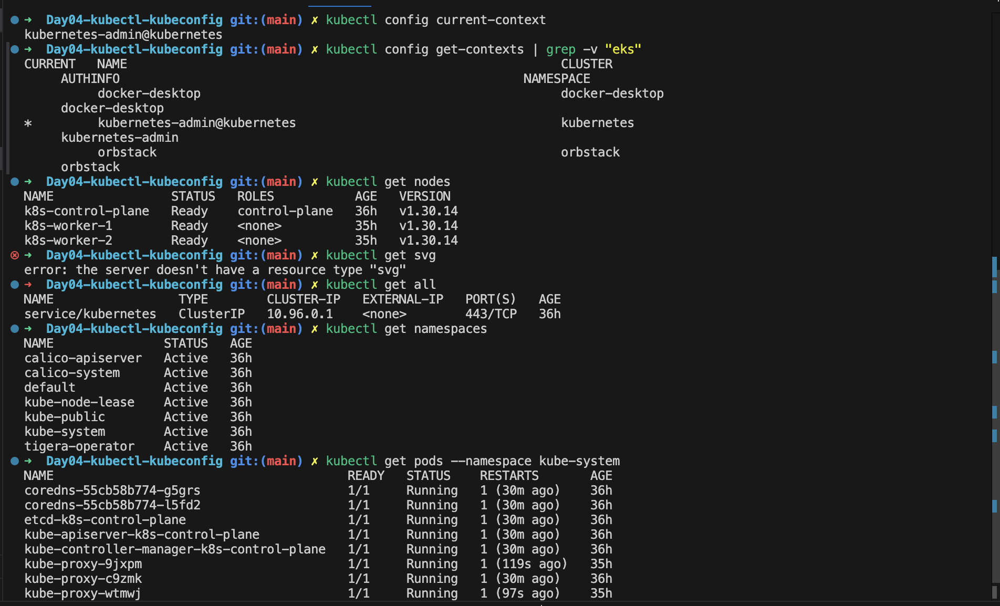

## Day 4: kubeconfig, Contexts and Namespaces

## What is kubectl?

`kubectl` is the official Kubernetes command-line interface.

It allows administrators and developers to interact with the Kubernetes API Server.

Examples of common tasks include:

- Listing nodes
- Viewing Pods
- Creating Deployments
- Scaling applications
- Viewing logs
- Troubleshooting resources

For example:

```bash
kubectl get nodes
```

This command retrieves information about all nodes from the Kubernetes API Server.

### How kubectl Works

When you execute:

```bash
kubectl get pods
```

the request follows this path:

```text
kubectl
   |
   v
kubeconfig
   |
   v
API Server
   |
   v
 etcd
```

`kubectl` never communicates directly with Pods or nodes.

Everything goes through the API Server.

This ensures:

- Authentication
- Authorization
- Auditing
- Centralized management

---

## What is kubeconfig?

A kubeconfig file contains information required for `kubectl` to connect to a cluster.

It includes:

- Cluster details
- User credentials
- Contexts
- Certificates
- API Server endpoints

The default location is:

```text
~/.kube/config
```

Without kubeconfig, `kubectl` cannot determine:

- Which cluster to connect to
- Which user to use
- Which context is active

---

## Anatomy of a kubeconfig File

A kubeconfig file contains three primary sections.

### Cluster

Defines the Kubernetes API endpoint.

Example:

```yaml
clusters:
- cluster:
    server: https://172.16.10.2:6443
```

### User

Defines credentials used for authentication.

Example:

```yaml
users:
- name: kubernetes-admin
```

### Context

Maps a user to a cluster.

Example:

```yaml
contexts:
- context:
    cluster: kubernetes
    user: kubernetes-admin
```

Think of a context as:

> Use this user to connect to this cluster.

---

## Lab 1: View kubeconfig

Display your current configuration:

```bash
kubectl config view
```

You should see output containing:

- clusters
- users
- contexts

Observe:

- Current cluster
- API Server endpoint
- User information

This is the configuration `kubectl` uses every time it communicates with Kubernetes.

### Check Current Context

Display the currently active context:

```bash
kubectl config current-context
```

Example output:

```text
kubernetes-admin@kubernetes
```

This tells `kubectl` which cluster and user combination is currently active.

### Understanding Contexts

Contexts become especially useful when managing multiple clusters.

Example:

- Development Cluster
- Testing Cluster
- Production Cluster

Instead of maintaining separate configuration files, `kubectl` allows switching between contexts.

View all contexts:

```bash
kubectl config get-contexts
```

Example:

```text
CURRENT   NAME
*         kubernetes-admin@kubernetes
```

The asterisk identifies the active context.

---

## Common kubectl Commands

List nodes:

```bash
kubectl get nodes
```

List Pods:

```bash
kubectl get pods -A
```

List namespaces:

```bash
kubectl get namespaces
```

List services:

```bash
kubectl get svc
```

List deployments:

```bash
kubectl get deployments
```

List every resource in a namespace:

```bash
kubectl get all
```

These commands become second nature for Kubernetes administrators.

---

## Understanding Namespaces

Namespaces provide logical separation within a Kubernetes cluster.

Think of namespaces as folders used to organize resources.

Examples:

- default
- kube-system
- monitoring
- development
- production

Namespaces help isolate workloads and simplify administration.

---

## Lab 2: View Available Namespaces

Run:

```bash
kubectl get namespaces
```

Expected output:

```text
NAME              STATUS
default           Active
kube-system       Active
kube-public       Active
kube-node-lease   Active
```

### Access Resources in Specific Namespaces

View Pods in the default namespace:

```bash
kubectl get pods
```

View Pods in kube-system:

```bash
kubectl get pods --namespace kube-system
```

Or using the short form:

```bash
kubectl get pods -n kube-system
```

You should see system components such as:

- CoreDNS
- etcd
- kube-apiserver
- kube-scheduler
- kube-controller-manager

---

## Why Namespaces Matter

Imagine a production cluster containing:

- Frontend Applications
- Backend Applications
- Monitoring Stack
- Logging Stack
- Platform Services

Without namespaces, every resource would exist together.

Namespaces provide structure and isolation.

Most enterprise Kubernetes clusters rely heavily on namespaces.

---

## Useful Output Formats

View detailed node information:

```bash
kubectl get nodes -o wide
```

View YAML output:

```bash
kubectl get node k8s-worker-1 -o yaml
```

View JSON output:

```bash
kubectl get node k8s-worker-1 -o json
```

YAML output is particularly useful for troubleshooting and exam preparation.

---

## Real-World Scenario

A developer reports:

> My application is missing.

You run:

```bash
kubectl get pods
```

No Pods appear.

You assume the application was deleted.

Then you discover it exists in a different namespace:

```bash
kubectl get pods -A
```

Output:

```text
NAMESPACE     NAME
production    web-app
```

Always verify namespaces before troubleshooting.

---

## Troubleshooting

### Problem

`kubectl` cannot connect to the cluster.

Example:

```text
The connection to the server localhost:8080 was refused
```

### Investigation

Verify kubeconfig exists:

```bash
ls ~/.kube/config
```

Check current context:

```bash
kubectl config current-context
```

Check cluster information:

```bash
kubectl cluster-info
```

Most `kubectl` connection issues originate from missing or incorrect kubeconfig files.

## Configuration
