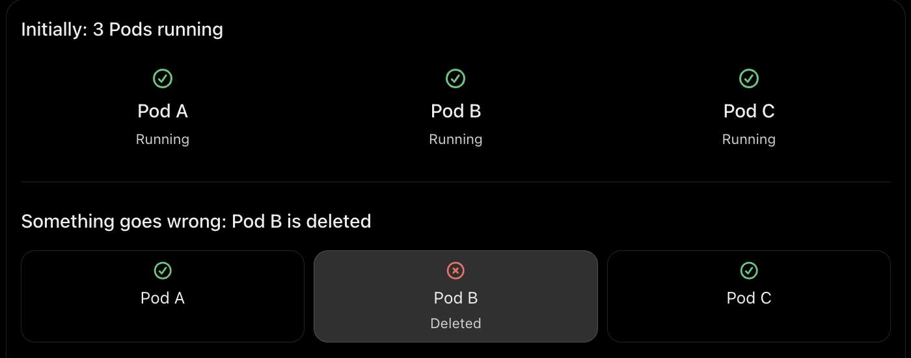
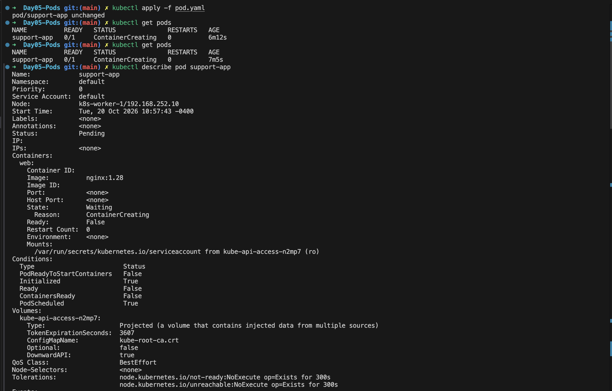
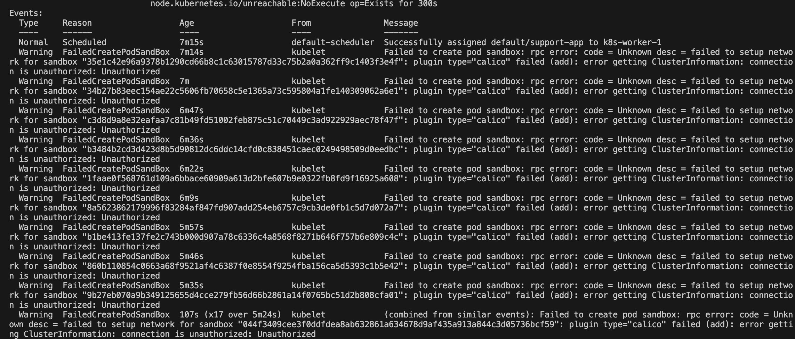
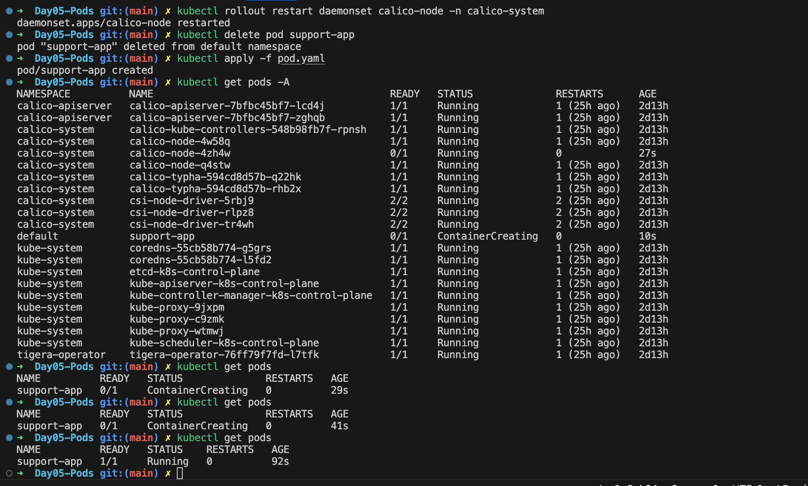

## Day 5: Deploying Your First Workload - The Pod

Today, Day 05, let's deploy our first Kubernetes workload.

To do that, we need to understand the most fundamental object in Kubernetes:

**The Pod**

Everything in Kubernetes ultimately runs inside a Pod.

- Deployments create Pods.
- StatefulSets create Pods.
- DaemonSets create Pods.
- Jobs create Pods.

---

## What is a Pod?

A Pod is the smallest deployable unit in Kubernetes. A Pod represents one or more containers running together on the same node. Think of a Pod as a wrapper around a container. Pods are ephemeral in nature.

Imagine you manually create a Pod:

```bash
kubectl run support-app --image=nginx
```

Kubernetes creates a Pod named `support-app` and starts the container inside it.

Now imagine that Pod gets deleted or its worker node fails.

The original Pod might disappear permanently. Kubernetes does not promise to bring back that exact Pod.

You might think, "But my application must keep running. Who creates another Pod?"

That is exactly where a Deployment comes in.

---

## Why Do We Need Pods?

Pods provide several capabilities that individual containers cannot.

A Pod gives containers:

- Shared networking
- Shared storage
- Shared lifecycle
- Shared configuration

Every container inside the same Pod:

- Shares the same IP address
- Communicates using `localhost`
- Can access shared volumes

---

## Pod Lifecycle

A Pod moves through several states during its lifetime.

```text
Pending
   |
Running
   |
Succeeded
   |
Failed
```

Most healthy application Pods should remain in:

```text
Running
```

You can check Pod status using `kubectl`.

---

## Creating Your First Pod

Let's create our first Pod.

Run:

```bash
kubectl run nginx --image=nginx
```

Expected output:

```text
pod/nginx created
```

### Verify Pod Creation

Check the Pod:

```bash
kubectl get pods
```

Example:

```text
NAME    READY   STATUS    RESTARTS   AGE
nginx   1/1     Running   0          20s
```

A healthy Pod should show:

```text
STATUS = Running
```

### Inspect Pod Details

View detailed information:

```bash
kubectl describe pod nginx
```

This command is one of the most important troubleshooting tools in Kubernetes.

It reveals:

- Node assignment
- Container image
- Events
- Labels
- Conditions
- Networking information

Whenever a Pod isn't behaving correctly, start with:

```bash
kubectl describe pod <pod-name>
```

---

## Understanding Pod Placement

Find out which node is running the Pod.

Run:

```bash
kubectl get pods -o wide
```

Example:

```text
NAME    READY   STATUS    NODE
nginx   1/1     Running   k8s-worker-1
```

You'll notice Kubernetes automatically selected a node.

This decision was made by the Scheduler.

---

## Viewing Application Logs

Logs are one of the most commonly used troubleshooting tools.

View logs from the nginx Pod:

```bash
kubectl logs nginx
```

You may see web server startup messages.

In production environments,

```bash
kubectl logs <object>
```

to diagnose application failures.

---

## Watching Pod Activity in Real Time

Continuously monitor Pods:

```bash
kubectl get pods -w
```

The `-w` flag means watch.

You'll see status updates in real time.

This is extremely useful when:

- Creating Pods
- Restarting applications
- Troubleshooting deployments

Exit with:

```text
Ctrl + C
```

---

## Inspecting Pod YAML

Every Kubernetes object is represented as YAML.

But if you create this Pod directly and it is deleted, Kubernetes will not automatically create a replacement standalone Pod just because that Pod used to exist.

The Deployment provides the higher-level management you normally need for stateless applications.

For learning and debugging, creating a standalone Pod can be useful.

For production application workloads, Deployments are the usual choice because they support replica management, self-healing through controllers, rolling updates and rollbacks.

This doesn't mean engineers never create Pods in production. They generally avoid managing application Pods individually when a controller can manage them.

For example:



Now if pod deleted it would not autocreated so need deployment to maintain desire state which we cover in coming days.

---

## Common Pod TS Scenarios

### CrashLoopBackOff

The container starts and repeatedly crashes.

Investigate using:

```bash
kubectl logs <pod-name>
```

### ImagePullBackOff

Kubernetes cannot download the container image.

Common causes:

- Typographical errors
- Missing image repositories
- Network issues

---


## Real-World Troubleshooting: 

While working on this lab, my `support-app` Pod did not start as expected. This was a real issue in my cluster, so I am documenting how I diagnosed and fixed it.

### Step 1: Observe the Pod Status

The Pod stayed in `ContainerCreating` for more than 7 minutes with `READY 0/1`. I ran `kubectl describe pod support-app` to look deeper.



What the output tells us:

- **Node: `k8s-worker-1`**: the Pod was scheduled successfully, so the Scheduler did its job.
- **Status: `Pending`** and **State: `Waiting`** with **Reason: `ContainerCreating`**: the container has not started yet.
- **IP is empty**: the Pod never received an IP address.
- **Conditions**: `PodScheduled = True` and `Initialized = True`, but `PodReadyToStartContainers = False`, `ContainersReady = False` and `Ready = False`.

The Pod was placed on a node, but something stopped the container from starting. An empty IP points to a **networking problem**.

### Step 2: Read the Events

The answer is almost always at the bottom of `kubectl describe pod`, in the **Events** section.



What the events tell us:

- `Normal | Scheduled | default-scheduler`: the Pod was successfully assigned to `k8s-worker-1`.
- `Warning | FailedCreatePodSandbox | kubelet`: the kubelet could not create the Pod sandbox. This warning repeated many times (`x17 over 5m24s`).

The error message:

```text
Failed to create pod sandbox: rpc error: code = Unknown desc = failed to setup network for sandbox:
plugin type="calico" failed (add): error getting ClusterInformation: connection is unauthorized: Unauthorized
```

How to read it:

- **Pod sandbox**: before any container starts, the kubelet creates a sandbox that holds the Pod's network namespace.
- **`plugin type="calico" failed (add)`**: to set up that network, the kubelet calls the CNI plugin (Calico) on the node, and the call failed.
- **`connection is unauthorized: Unauthorized`**: the Calico plugin on the node could not authenticate to the Kubernetes API server. It is a credentials problem, not an application or image problem.

So the container was never the issue. Calico could not set up networking for the Pod, and without networking Kubernetes cannot start it.

### Step 3: Fix the Issue

Since the problem was with the Calico `calico-node` component on the worker nodes, I restarted the `calico-node` DaemonSet so its Pods start fresh and re-establish their connection to the API server. Then I deleted the stuck Pod and recreated it:

```bash
kubectl rollout restart daemonset calico-node -n calico-system
kubectl delete pod support-app
kubectl apply -f pod.yaml
kubectl get pods -A
kubectl get pods
```



What happened:

- `kubectl rollout restart daemonset calico-node -n calico-system`: the `calico-node` Pods were restarted one by one (visible in `kubectl get pods -A` with a new `calico-node` Pod showing a low AGE of `27s`).
- `kubectl delete pod support-app` followed by `kubectl apply -f pod.yaml`: the stuck Pod was removed and created again from the YAML file.
- Result: `support-app` moved from `ContainerCreating` to **`1/1 Running`**.

### Key Takeaways

1. **`ContainerCreating` for a long time is a warning sign**. Always run `kubectl describe pod <pod-name>` and read the **Events** section first.
2. **A Pod that is scheduled but has no IP usually points to a CNI/networking issue**, not an application issue.
3. **`FailedCreatePodSandbox` means the kubelet could not set up the Pod's network.** Read the plugin name in the error (here, Calico) to know which component to investigate.
4. **Check the CNI Pods** in their namespace (`calico-system` here) when Pods cannot start. A restart of the `calico-node` DaemonSet is a quick and safe first fix.
5. **Troubleshooting flow:** `kubectl get pods` → `kubectl describe pod` → read Events → find the failing component → fix → verify.