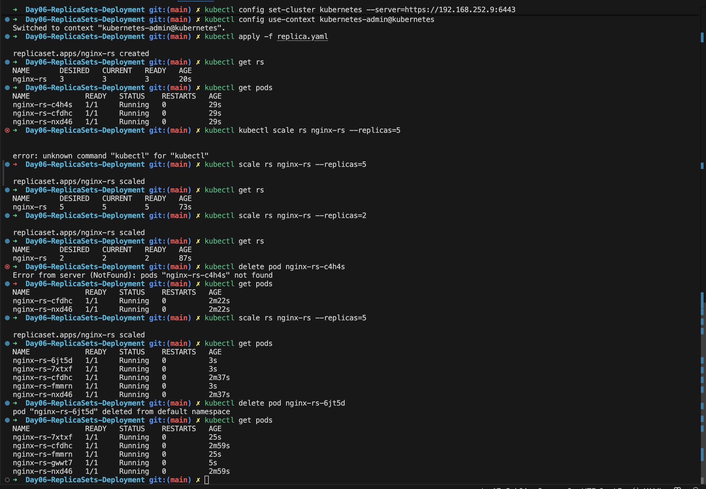
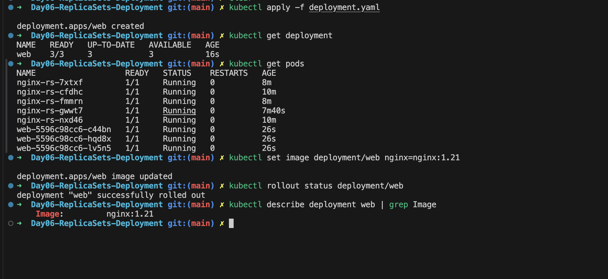

## Day 6: ReplicaSets

## What is a ReplicaSet?

A ReplicaSet is a Kubernetes object that maintains a stable set of replica Pods running at any given time.

Think of it as a controller that watches over Pods:

- If a Pod dies → ReplicaSet creates a new one
- If you scale replicas → ReplicaSet adds or removes Pods
- If Pods drift from desired state → ReplicaSet restores balance

Diagram:

```text
ReplicaSet
   |
   v
Multiple Pods
```

---

## Why Do We Need ReplicaSets?

Standalone Pods are fragile. If deleted, they don't come back. ReplicaSets solve this problem by ensuring desired state = actual state.

Benefits:

- **High Availability:** Keeps applications running even if Pods fail
- **Scalability:** Easily increase or decrease replicas
- **Self-Healing:** Automatically replaces failed Pods


Key sections:

- `replicas` → Desired number of Pods
- `selector` → Matches Pods controlled by ReplicaSet
- `template` → Pod specification

---

## Lab Exercises

### 1. Create ReplicaSet

```bash
kubectl apply -f nginx-rs.yaml
```

Verify:

```bash
kubectl get rs
kubectl get pods
```

Expected output:

```text
NAME        DESIRED   CURRENT   READY   AGE
nginx-rs    3         3         3       20s
```

### 2. Scale ReplicaSet

Increase replicas:

```bash
kubectl scale rs nginx-rs --replicas=5
```

Check:

```bash
kubectl get pods
```

Decrease replicas:

```bash
kubectl scale rs nginx-rs --replicas=2
```

### 3. Self-Healing Demo

Delete one Pod:

```bash
kubectl delete pod <pod-name>
```

Observe:

```bash
kubectl get pods
```

ReplicaSet immediately creates a new Pod to maintain desired count.

### 4. Inspect ReplicaSet

```bash
kubectl describe rs nginx-rs
```

Shows:

- Events
- Pod template
- Replica count

---

## Common ReplicaSet Issues

- **Selector mismatch** → ReplicaSet doesn't manage Pods correctly
- **ImagePullBackOff** → Pods fail due to bad image
- **Insufficient resources** → Pods stuck in Pending

---

## Interview Questions

1. **What is a ReplicaSet?**
   → A controller that ensures a specified number of Pods are running.
2. **How does ReplicaSet differ from a Pod?**
   → Pods are single units; ReplicaSets manage multiple Pods and ensure availability.
3. **What happens if you delete a Pod managed by ReplicaSet?**
   → ReplicaSet recreates it automatically.
4. **Which field defines how many Pods a ReplicaSet should run?**
   → `spec.replicas`
5. **Can ReplicaSets be used directly in production?**
   → Usually, Deployments are preferred since they manage ReplicaSets and provide rolling updates.


  


   ## Deployment 

## What is a Deployment?

A Deployment is a higher-level abstraction that manages ReplicaSets and Pods.

It provides:

- **Rolling Updates** → Gradually replace old Pods with new ones
- **Rollbacks** → Revert to a previous version if something goes wrong
- **Declarative Updates** → Define desired state in YAML, Kubernetes ensures it

Diagram:

```text
Deployment
   |
   v
ReplicaSet
   |
   v
Pods
```

---

## Why Do We Need Deployments?

ReplicaSets ensure Pods are running, but they don't handle application upgrades gracefully. Deployments solve this by:

- Updating Pods incrementally (rolling updates)
- Allowing rollback to stable versions
- Managing multiple ReplicaSets automatically

---

## Creating a Deployment

Imperative command:

```bash
kubectl create deployment web --image=nginx
```

Verify:

```bash
kubectl get deployments
kubectl get pods
```

Expected output:

```text
NAME   READY   UP-TO-DATE   AVAILABLE   AGE
web    1/1     1            1           20s
```

---

## Rolling Updates

Update the Deployment image:

```bash
kubectl set image deployment/web nginx=nginx:1.21
```

Check rollout status:

```bash
kubectl rollout status deployment/web
```

Kubernetes gradually replaces old Pods with new ones, ensuring zero downtime.

---

## Rollbacks

If the new version fails:

```bash
kubectl rollout undo deployment web
```

This reverts the Deployment to the previous stable ReplicaSet.

---

## Inspect Deployment

```bash
kubectl describe deployment web
```

Shows:

- Current ReplicaSet
- Events
- Rollout history

---

## Key Sections

- `replicas` → Defines how many Pods should run (here, 3).
- `selector` → Ensures the Deployment manages Pods with label `app: web`.
- `template` → Pod specification (metadata + container details).
- `containers` → Defines the container image (`nginx:latest`) and exposed port (80).


