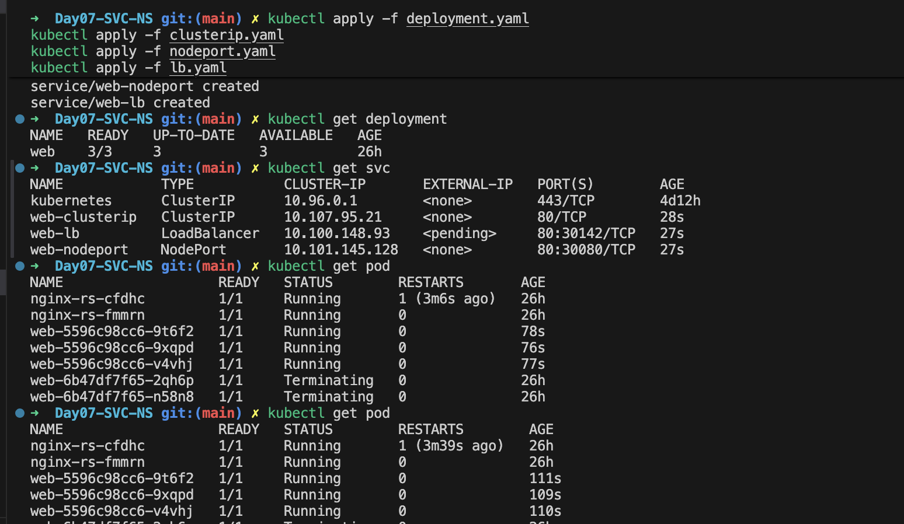
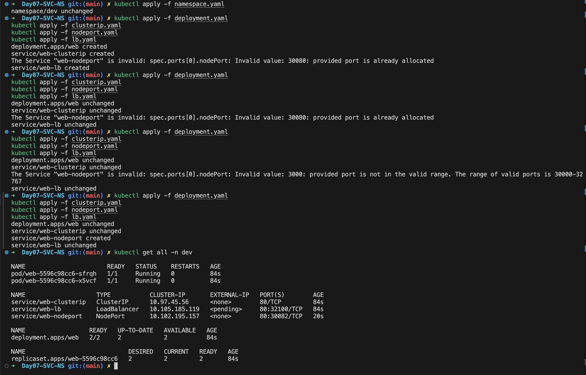

## Day 7: Kubernetes Services and Namespaces

Welcome to Day 07! Today we are going to learn about Services and Namespaces.

Yesterday we explored Pods, ReplicaSets, and Deployments.

These objects run workloads, but they don't automatically expose applications to other Pods or external users. That's where Services come in.

A Service is a stable networking abstraction that allows communication with Pods, regardless of their IP addresses or lifecycle changes.

---

## What is a Service?

Pods are ephemeral — they can be created, destroyed, or rescheduled on different nodes. Their IP addresses change frequently.

### 1. Who gives the Pod its IP?

First, understand who gives the Pod its IP:

The Kubernetes scheduler schedules the Pod onto a worker node.

- The node's networking setup, typically managed by a CNI (Container Network Interface) plugin, configures networking for the Pod.
- The networking plugin allocates or configures a Pod IP from the cluster's Pod network and makes the necessary network routes work.

> **The key point:** The Pod's IP comes from the cluster's networking system.

A Service provides a stable endpoint (DNS name + virtual IP) to access Pods.

### 2. Where does the Service get its stable IP?

The range used for Service IPs is configured for the Kubernetes cluster, commonly through the API server's `--service-cluster-ip-range` setting in self-managed clusters. Managed services such as EKS handle the control plane configuration for you.

For example, the cluster might use a Service CIDR of `10.96.0.0/12`. Kubernetes allocates an available IP from that range.

> **Important:** This is a virtual cluster IP. It is not the IP of a worker node, nor is it an IP assigned to one of your Pods.

The IP generally remains stable for the lifetime of that Service. If you delete the Service and create another one, the new Service may receive a different IP.

### 3. Where does the Service get its DNS name?

Kubernetes has an internal DNS system, typically CoreDNS, which resolves Service names for applications inside the cluster.

Suppose the Service is named:

```yaml
metadata:
  name: support-service
```

And it lives in the `default` namespace.

Its DNS name is typically:

```text
support-service.default.svc.cluster.local
```

Here's how the pieces fit together:

| DNS part | Meaning |
|---|---|
| `support-service` | Service name |
| `default` | Namespace |
| `svc` | Indicates a Kubernetes Service |
| `cluster.local` | Default cluster DNS domain; it can be configured differently |

---

## Who creates what?

Keep this simple breakdown in your mind:

- **Kubernetes API server:** Assigns and records the Service's ClusterIP.
- **CoreDNS:** Makes the Service discoverable by DNS name.
- **EndpointSlice controller:** Tracks the IP addresses and ports of matching Pod endpoints.
- **Service networking layer:** Routes traffic from the Service IP and port to an eligible endpoint.

Diagram:

```text
Client
   |
Service (Stable IP/DNS)
   |
Pods (Dynamic IPs)
```

---

## Types of Services

### ClusterIP

- Default Service type
- Exposes Pods internally within the cluster
- Not accessible from outside the cluster

Example use case: Backend microservices communicating with each other.

### NodePort

- Exposes Pods on a static port across all nodes
- Accessible externally via `<NodeIP>:<NodePort>`
- Useful for quick external access without a load balancer

### LoadBalancer

- Integrates with cloud provider load balancers
- Exposes Pods externally with a single IP
- Best for production workloads needing external traffic routing

---

## Common Service Issues

- **Selector mismatch** → Service doesn't route traffic to Pods
- **Firewall rules** → NodePort/LoadBalancer blocked externally
- **Pending external IP** → LoadBalancer not provisioned in local clusters

---

## Key Takeaways

- Services provide stable networking for Pods
- ClusterIP, NodePort, and LoadBalancer are the main types
- YAML manifests define selectors, ports, and type
- Services enable internal and external communication
- They are essential for connecting workloads in Kubernetes




# Namespaces

As clusters grow, we need a way to organize and isolate resources. That's where Namespaces come in.

Namespaces provide logical isolation within a Kubernetes cluster, allowing administrators to group resources, enforce policies, and manage multi-tenant environments.

---

## What is a Namespace?

A Namespace is a virtual cluster inside Kubernetes. It allows you to divide resources logically without spinning up separate physical clusters.

Diagram:

```text
Cluster
 ├── Namespace: dev
 │     ├── Pods
 │     ├── Services
 │     └── ConfigMaps
 ├── Namespace: prod
 │     ├── Pods
 │     ├── Services
 │     └── Secrets
 └── Namespace: kube-system
       ├── Core components
```

---

## Why Do We Need Namespaces?

Namespaces help with:

- **Isolation** → Separate dev, test, and prod environments
- **Organization** → Group related resources together
- **Access Control** → Apply RBAC policies per Namespace
- **Resource Quotas** → Limit CPU/memory usage per Namespace

---

## Default Namespaces

Kubernetes comes with a few built-in Namespaces:

- `default` → Where resources go if no Namespace is specified
- `kube-system` → System Pods (scheduler, controller manager, etc.)
- `kube-public` → Publicly accessible resources
- `kube-node-lease` → Tracks node heartbeat leases

---

## Common Namespace Issues

- **Forgot to specify Namespace** → Resources end up in `default`
- **RBAC restrictions** → User lacks permissions in certain Namespaces
- **Resource quota exceeded** → Pod creation fails due to limits

---

## Key Takeaways

- Namespaces provide logical isolation in Kubernetes
- They organize resources and enforce policies
- Default Namespaces include `default`, `kube-system`, `kube-public`, and `kube-node-lease`
- You can create custom Namespaces for dev, test, and prod environments
- Namespaces are essential for multi-tenant clusters and resource management


