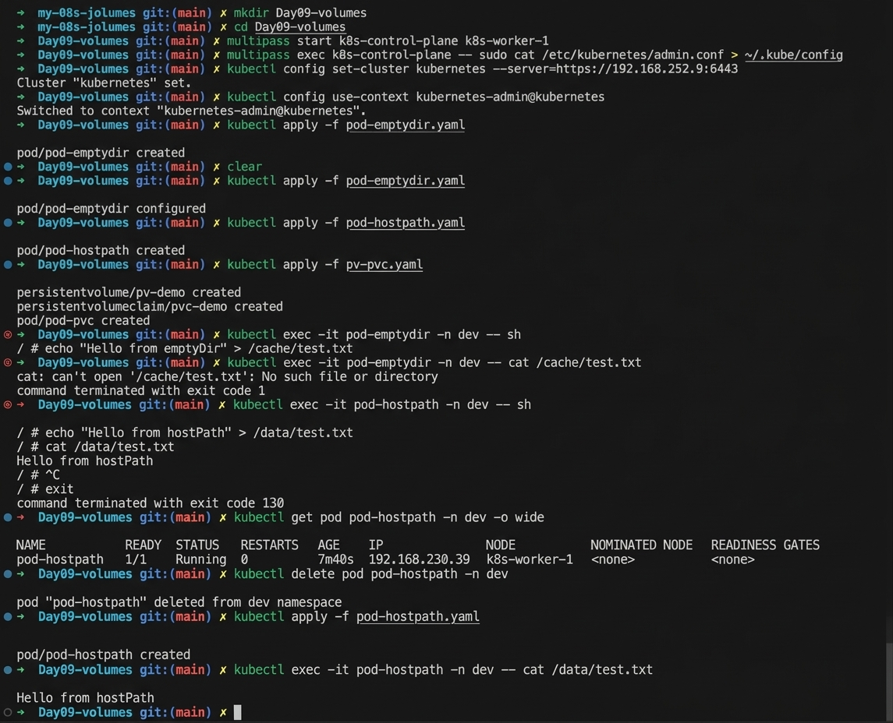
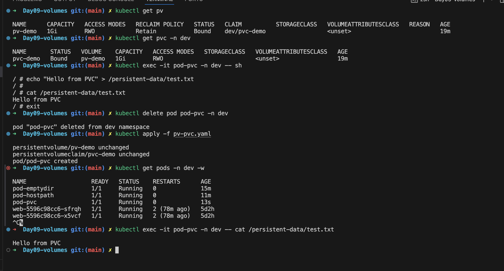

## Day 9: Volumes - Kubernetes Storage

Yesterday, we explored Secrets for secure data management. Today, we'll focus on Volumes — the foundation of Kubernetes storage.

Pods are ephemeral: when a Pod dies, its container filesystem is lost. Volumes solve this by providing storage that is managed by Kubernetes. Depending on the volume type, that storage can survive container restarts, outlive the Pod, and be shared between containers.

---

## What is a Volume?

A Volume is a directory accessible to containers in a Pod. Unlike container filesystems, Volumes are managed by Kubernetes and can persist data beyond container restarts.

Diagram:

```text
Pod
 ├── Container A
 ├── Container B
 └── Shared Volume
```

---

## Why Do We Need Volumes?

- **Persistence** → Retain data beyond container restarts, and with the right volume type, beyond the Pod lifecycle
- **Sharing** → Allow multiple containers in a Pod to access the same files
- **Flexibility** → Support different storage backends (local disk, cloud storage, NFS, etc.)

---

## Types of Volumes (Basics)

### emptyDir

- Created when a Pod starts
- Lives as long as the Pod runs
- Useful for scratch space or temporary files
- Can be backed by memory (`medium: Memory`) for fast temporary storage

### hostPath

- Maps a directory from the node's filesystem into the Pod
- Useful for accessing node-level files
- Risky in production due to tight coupling with the node

### PersistentVolumeClaim (PVC)

- Requests storage from a PersistentVolume (PV)
- Provides durable storage independent of Pod lifecycle

```bash
kubectl apply -f pv-pvc.yaml
```

---

## Deep Dive: PersistentVolume (PV) and PersistentVolumeClaim (PVC) 

### The problem they solve

With `emptyDir` and `hostPath`, the developer has to know where the storage lives. A real application should not care whether its data sits on an AWS disk, an NFS server or a Ceph cluster. Kubernetes separates the two sides:

- The **cluster admin / storage team** decides what storage exists (PV).
- The **developer** only asks for the storage they need (PVC).

### What is a PersistentVolume (PV)?

A PV is a Kubernetes object that represents a real piece of storage that already exists in the cluster's environment, for example a cloud disk, an NFS share or a directory on a node.

- It is **cluster-scoped** (it does not belong to any Namespace).
- It is **not** the storage itself. It is the Kubernetes record that points to the storage (disk ID, NFS server and path, etc.).
- It has a capacity, access modes, a reclaim policy and an optional StorageClass.

### What is a PersistentVolumeClaim (PVC)?

A PVC is a request for storage made by a user. It says "I need 1Gi, readable and writable by one node" and Kubernetes finds or creates a matching PV.

- It is **Namespace-scoped**.
- The Pod never references the PV directly. The Pod references the PVC, and the PVC is bound to a PV.

### Simple analogy

```text
PV   = a parking space that exists in the car park
PVC  = a parking request: "I need one space for a small car"
Pod  = the car that uses the space it was given
```

The Pod uses the claim, the claim is matched to a space, and the actual space is provided by the car park (the storage backend).

### Where does the storage actually come from?

Kubernetes itself does not store any data. It only connects Pods to storage that already exists somewhere else. The real storage is always provided by a **storage backend**:

| Storage backend | Examples | Typical access mode | Survives node failure? |
|---|---|---|---|
| Cloud block disk | AWS EBS, Azure Disk, GCE Persistent Disk | ReadWriteOnce | Yes (disk is outside the node) |
| Cloud file share | AWS EFS, Azure Files, GCP Filestore | ReadWriteMany | Yes |
| Network file system | NFS server | ReadWriteMany | Yes (if the NFS server is healthy) |
| Distributed storage | Ceph/Rook, Longhorn, GlusterFS | ReadWriteOnce / ReadWriteMany | Yes (data is replicated across nodes) |
| Local disk on a node | `local` volume, `hostPath` | ReadWriteOnce | No (data stays on that node) |
| Enterprise SAN/NAS | NetApp, Pure Storage, Dell | Varies | Yes |

### Who creates the PV? Two ways

#### 1. Static provisioning (admin creates PVs by hand)

1. The admin creates the storage (for example an NFS share or a disk).
2. The admin creates a PV object that points to it.
3. A developer creates a PVC.
4. Kubernetes matches the PVC to a suitable PV and binds them.

This is what we do in the lab on a local kubeadm cluster.

#### 2. Dynamic provisioning (PV is created automatically)

This is how most real clusters work. It uses a **StorageClass**.

1. The admin creates a **StorageClass**. It names a **provisioner** (a CSI driver) and its settings, for example "type gp3 disks on AWS".
2. A developer creates a PVC that names the StorageClass (or uses the default one).
3. The provisioner calls the storage backend API (for example "create a 1Gi EBS volume").
4. The provisioner creates the PV object that points to the new volume.
5. Kubernetes binds the PVC to that PV.

Nobody has to create the disk or the PV by hand.


### What is CSI?

**CSI (Container Storage Interface)** is the standard plug-in system that lets Kubernetes talk to any storage system, the same way CNI does for networking. Each storage vendor ships a CSI driver, so Kubernetes does not need storage-specific code built in.

A CSI driver has two parts:

- **Controller plugin** (runs as a Deployment): creates, deletes, attaches and detaches volumes through the storage backend API. It runs with helper sidecars such as `external-provisioner` and `external-attacher`.
- **Node plugin** (runs as a DaemonSet on every node): formats and mounts the volume on the node where the Pod runs.

### Under the hood: what happens step by step (dynamic provisioning)

```text
1. You create a PVC (1Gi, storageClassName: fast-disk)
        |
        v
2. API server stores the PVC in etcd. Status: Pending
        |
        v
3. external-provisioner (CSI controller sidecar) sees the PVC
   and calls the storage backend: "create a 1Gi volume"
        |
        v
4. Backend creates the real volume (for example an EBS disk)
        |
        v
5. Provisioner creates the PV object that points to that volume
        |
        v
6. PV controller (in kube-controller-manager) binds PVC <-> PV
   PVC status: Bound
        |
        v
7. Pod using the PVC is scheduled onto a node
        |
        v
8. Volume is attached to that node (VolumeAttachment, done by the
   attach/detach controller and the CSI external-attacher)
        |
        v
9. Kubelet asks the CSI node plugin to format and mount the volume
   on the node, then bind-mounts it into the container path
        |
        v
10. The container reads and writes to /persistent-data
```

For static provisioning, steps 3 to 5 are skipped, because the admin has already created the PV.

### How a PVC finds a matching PV (binding rules)

The PV controller binds a PVC to a PV when all of these match:

- **Capacity:** the PV is at least as big as the request. A 5Gi PV can satisfy a 1Gi claim, and the claim gets the whole 5Gi PV.
- **Access modes:** the PV supports the modes the PVC asks for.
- **StorageClass:** `storageClassName` is the same on both. An empty string (`""`) means "no class", so only a PV without a class can match.
- **Volume mode:** both are `Filesystem` (default) or both are `Block`.
- **Selector (optional):** the PVC can select PVs by label.

PV and PVC are bound **one to one**. Once a PV is bound to a PVC, no other claim can use it.

### Access modes

| Mode | Short | Meaning |
|---|---|---|
| ReadWriteOnce | RWO | Read-write by a single node |
| ReadOnlyMany | ROX | Read-only by many nodes |
| ReadWriteMany | RWX | Read-write by many nodes |
| ReadWriteOncePod | RWOP | Read-write by a single Pod only |

Block disks like EBS are normally RWO. For RWX you need a file system such as NFS, EFS or CephFS.

### Reclaim policy: what happens to the PV when the PVC is deleted

| Policy | Behavior |
|---|---|
| `Retain` | The PV and its data are kept. An admin must clean up and reuse it manually. |
| `Delete` | The PV and the real backend volume are deleted. This is the default for dynamically created PVs. |
| `Recycle` | Old and deprecated. Do not use. |

### PV and PVC states

- **PV:** `Available` → `Bound` → `Released` (claim deleted, waiting for the admin) → `Failed`
- **PVC:** `Pending` (no matching PV yet) → `Bound` → `Lost` (the PV disappeared)

### volumeBindingMode: WaitForFirstConsumer

With the default `Immediate` mode, the volume is created as soon as the PVC exists, possibly in the wrong zone. With `WaitForFirstConsumer`, Kubernetes waits until a Pod is scheduled, then creates the volume where the Pod actually runs. This is important for zone-bound disks such as AWS EBS, which can only attach to a node in the same Availability Zone. In this mode a PVC stays `Pending` until a Pod uses it. That is normal.

### What happens when things are deleted?

- **Delete the Pod** → the PVC and PV stay, and the data stays. A new Pod using the same PVC sees the same data.
- **Delete the PVC** → the PV follows its reclaim policy (`Retain` or `Delete`).
- **Delete a PVC that a Pod is still using** → Kubernetes protects it. The PVC stays in `Terminating` until the Pod is gone.

### What does this mean for my lab cluster and for EKS?

- **Local kubeadm cluster on Multipass (this lab):** there is no cloud and no default StorageClass, so dynamic provisioning is not available. We create the PV by hand (static provisioning), backed by a directory on a worker node. A PVC that asks for a StorageClass that doesn't exist stays `Pending`.
- **EKS:** the AWS EBS CSI driver and a StorageClass (for example `gp3`) are used, so creating a PVC automatically creates an EBS volume. An EBS volume belongs to one Availability Zone, so the Pod must run in the same zone.

### StatefulSets and storage

Databases usually run as StatefulSets. A StatefulSet uses `volumeClaimTemplates` to create one PVC per replica automatically (`data-mysql-0`, `data-mysql-1`, ...), so each replica keeps its own data even when its Pod is rescheduled.

---

## Verification and Testing

> The lab uses the `dev` Namespace. Create it first if it doesn't exist: `kubectl create namespace dev`

### Test 1: emptyDir Volume

#### Create a File

Enter the Pod:

```bash
kubectl exec -it pod-emptydir -n dev -- sh
```

Create a file inside the volume:

```bash
echo "Hello from emptyDir" > /cache/test.txt
cat /cache/test.txt
```

Expected output:

```text
Hello from emptyDir
```

#### Delete and Recreate the Pod

```bash
kubectl delete pod pod-emptydir -n dev
kubectl apply -f pod-emptydir.yaml
```

Wait until the Pod returns to the `Running` state:

```bash
kubectl get pods -n dev -w
```

#### Verify Data

```bash
kubectl exec -it pod-emptydir -n dev -- cat /cache/test.txt
```

Expected output:

```text
cat: can't open '/cache/test.txt': No such file or directory
```

#### Result

```text
Container Restart  - Data Survives
Pod Deletion       - Data Lost
Node Failure       - Data Lost
```

`emptyDir` exists only for the lifetime of the Pod.

### Test 2: hostPath Volume

#### Create a File

Enter the Pod:

```bash
kubectl exec -it pod-hostpath -n dev -- sh
```

Create a file:

```bash
echo "Hello from hostPath" > /data/test.txt
cat /data/test.txt
```

Expected output:

```text
Hello from hostPath
```

#### Verify on the Worker Node

Find where the Pod is running:

```bash
kubectl get pod pod-hostpath -n dev -o wide
```

Example:

```text
NAME           NODE
pod-hostpath   k8s-worker-1
```

Log in to that node (for Multipass: `multipass shell k8s-worker-1`) and verify:

```bash
cat /var/data/test.txt
```

Expected output:

```text
Hello from hostPath
```

#### Delete and Recreate the Pod

```bash
kubectl delete pod pod-hostpath -n dev
kubectl apply -f pod-hostpath.yaml
```

#### Verify Data Again

```bash
kubectl exec -it pod-hostpath -n dev -- cat /data/test.txt
```

Expected output:

```text
Hello from hostPath
```

#### Result

```text
Container Restart  - Data Survives
Pod Deletion       - Data Survives (only if the new Pod runs on the same node)
Node Failure       - Data Lost
```

Because the data is stored on the worker node filesystem. If the Pod is recreated on a different node, it will not see the file.




### Test 3: PersistentVolume + PersistentVolumeClaim

#### Verify PVC Binding

Check the Persistent Volume:

```bash
kubectl get pv
```

Expected output:

```text
NAME      CAPACITY   STATUS   CLAIM
pv-demo   1Gi        Bound    dev/pvc-demo
```

Check the Persistent Volume Claim:

```bash
kubectl get pvc -n dev
```

Expected output:

```text
NAME       STATUS   VOLUME
pvc-demo   Bound    pv-demo
```

#### Create a File

Enter the Pod:

```bash
kubectl exec -it pod-pvc -n dev -- sh
```

Create a file:

```bash
echo "Hello from PVC" > /persistent-data/test.txt
cat /persistent-data/test.txt
```

Expected output:

```text
Hello from PVC
```

#### Delete the Pod

```bash
kubectl delete pod pod-pvc -n dev
```

Recreate the resources:

```bash
kubectl apply -f pv-pvc.yaml
```

Wait until the Pod starts:

```bash
kubectl get pods -n dev -w
```

#### Verify Data Persistence

```bash
kubectl exec -it pod-pvc -n dev -- cat /persistent-data/test.txt
```

Expected output:

```text
Hello from PVC
```

#### Result

```text
Container Restart  - Data Survives
Pod Deletion       - Data Survives
Node Failure       - Depends on Storage Backend
```

For cloud-backed storage such as AWS EBS, Azure Disk, NFS, Ceph, or Longhorn, the data survives node failures as well. In this lab the PV is backed by a node directory, so it does not.

---



Notes on this lab setup:

- The PV uses `hostPath` because a local kubeadm cluster has no cloud disks or StorageClass provisioner. It is fine for learning, but not for production.
- `storageClassName: manual` is just a label. It makes sure this PVC binds to this PV and not to some other PV.
- Change `k8s-worker-1` to the name of your own worker node (`kubectl get nodes`).

---

## Key Takeaway

- `emptyDir` is temporary storage tied to the Pod lifecycle.
- `hostPath` stores data on the worker node filesystem.
- Persistent Volumes and PVCs provide durable storage independent of Pods.
- Stateful applications such as MySQL, PostgreSQL, MongoDB, Kafka and Jenkins should use PVCs rather than emptyDir or hostPath.

---

## Common Volume Issues

- **Pod stuck in Pending** → PVC not bound to PV
- **hostPath conflicts** → Directory missing or permissions denied
- **Data loss** → Using emptyDir when persistence is required
- **PVC stuck in Pending** (Added) → no PV matches (size, access mode or StorageClass), the StorageClass doesn't exist, or the volume is waiting for a Pod (`WaitForFirstConsumer`). Run `kubectl describe pvc <name>` and read the Events.
- **Pod can't mount the volume** (Added) → `FailedMount` or `FailedAttachVolume` events. Common causes are a disk in a different Availability Zone, or an RWO volume still attached to another node.
- **Data not found after Pod recreated** (Added) → with hostPath or a local PV, the new Pod was scheduled on a different node.
- **PV stuck in Released** (Added) → the claim was deleted but the reclaim policy is `Retain`. An admin must clean it up before it can be reused.

---

## Interview Questions

1. **What is a Volume in Kubernetes?**
   → A directory accessible to containers in a Pod, managed by Kubernetes.
2. **Difference between emptyDir and hostPath?**
   → emptyDir is ephemeral storage tied to Pod lifecycle; hostPath maps node filesystem into Pod.
3. **What is a PersistentVolumeClaim?**
   → A request for storage from a PersistentVolume.
4. **Can Volumes be shared between containers?**
   → Yes, multiple containers in a Pod can mount the same Volume.
5. **Why is hostPath discouraged in production?**
   → It tightly couples Pods to specific nodes, reducing portability.
6. **What is the difference between a PV and a PVC?** (Added)
   → A PV is a piece of storage in the cluster (cluster-scoped), usually created by an admin or a provisioner. A PVC is a user's request for storage (Namespace-scoped) that gets bound to a PV.
7. **Who creates the PV?** (Added)
   → An admin by hand (static provisioning), or a CSI provisioner automatically when a PVC uses a StorageClass (dynamic provisioning).
8. **What is a StorageClass?** (Added)
   → It describes a type of storage (provisioner, parameters, reclaim policy, binding mode) and lets Kubernetes create PVs on demand.
9. **What is CSI?** (Added)
   → The Container Storage Interface, a standard plug-in API that lets Kubernetes use any storage system through a driver.
10. **What happens to the data when a Pod using a PVC is deleted?** (Added)
    → The PVC and PV remain, and the data stays. A new Pod using the same PVC sees the same data.
11. **What happens to the PV when its PVC is deleted?** (Added)
    → It depends on the reclaim policy: `Retain` keeps the PV and data, `Delete` removes the PV and the backend volume.

---

## CKA Tips

- Practice creating Pods with emptyDir and hostPath.
- Be comfortable writing PV + PVC manifests quickly.
- Remember: PVCs are Namespace-scoped, PVs are cluster-scoped.
- Always check `kubectl describe pvc` to troubleshoot binding issues.
- In exams, expect tasks like:
  - Create Pod with emptyDir
  - Bind PVC to PV
  - Mount storage into Pod
- Know the default StorageClass commands: `kubectl get storageclass` and `kubectl describe storageclass <name>`. (Added)

---

## Key Takeaways


- Volumes provide persistent and shared storage for Pods
- emptyDir, hostPath, and PVC are the basic types
- Declarative manifests define how storage is mounted
- PersistentVolumes + PVCs enable durable storage across Pod lifecycles
- Storage is critical for stateful applications in Kubernetes
- A PV is real storage registered in the cluster, a PVC is a request for it, and the actual storage always comes from a backend such as cloud disks, NFS or Ceph
- PVs are created by an admin (static) or automatically through a StorageClass and a CSI driver (dynamic)