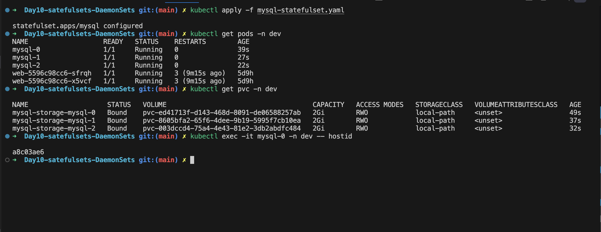
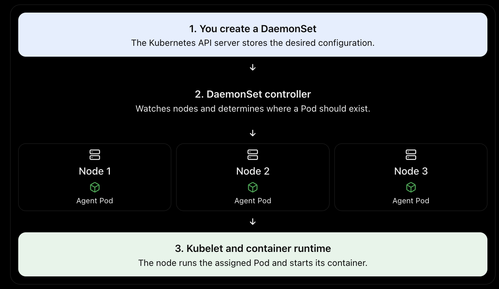
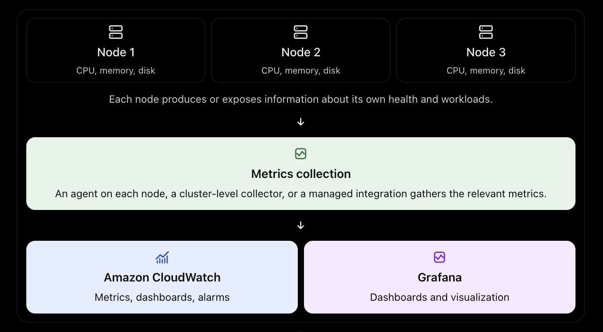

# Day 10: StatefulSets — Running Stateful Applications on Kubernetes

> Day 8 covered Secrets, Day 9 covered Volumes, PV and PVC. Today we put them together with a **StatefulSet**, the controller built for workloads that need a **stable identity** and **their own persistent storage**.


## 1. What is a StatefulSet?

A **StatefulSet** is a workload controller for **stateful applications**: apps that must remember who they are and keep their own data.

Every Pod managed by a StatefulSet gets:

| Guarantee | What it means |
|---|---|
| **Stable name** | Pods are numbered `mysql-0`, `mysql-1`, `mysql-2` and keep that name after restarts or rescheduling |
| **Stable DNS** | Each Pod gets a predictable DNS name: `mysql-0.mysql.dev.svc.cluster.local` |
| **Stable storage** | Each Pod gets its **own** PVC, which is re-attached to the same Pod every time |
| **Ordered operations** | Pods are created in order (0, 1, 2), deleted in reverse (2, 1, 0), and updated in reverse |

> **Important:** the Pod's **IP address is NOT stable**. It can change on every restart. The name, DNS entry and PVC are what stay fixed. This is why applications must talk to Pods by DNS name, never by IP.

---

## 2. Why do we need it?

- **Databases**: MySQL, PostgreSQL and MongoDB need stable storage and identity.
- **Distributed systems**: Kafka, ZooKeeper, etcd and Cassandra need ordered startup and stable member names.
- **Per-Pod persistence**: each Pod keeps its own data volume, so data survives restarts and rescheduling.

---

## 3. Deployment vs StatefulSet

| Feature | Deployment | StatefulSet |
|---|---|---|
| Use case | Stateless apps (Nginx, APIs) | Stateful apps (databases, brokers) |
| Pod names | Random (`mysql-abc123`) | Ordered (`mysql-0`, `mysql-1`) |
| Pod identity after restart | New identity | **Same identity** |
| DNS per Pod | No (only the Service name) | **Yes** (via headless Service) |
| Storage | Shared PVC or none | **Separate PVC per Pod** (`volumeClaimTemplates`) |
| Startup order | All at once (parallel) | Sequential by default (0, then 1, then 2) |
| Scale down | Removes any Pod | Removes the highest ordinal first |
| Rolling update | Any order | Reverse ordinal order (2, 1, 0) |

```
Deployment                          StatefulSet
──────────                          ───────────
mysql-7f9c-abc12  ──┐               mysql-0 ──► PVC data-mysql-0 ──► PV
mysql-7f9c-def34  ──┼─► ONE PVC?    mysql-1 ──► PVC data-mysql-1 ──► PV
mysql-7f9c-ghi56  ──┘  (conflict)   mysql-2 ──► PVC data-mysql-2 ──► PV
random names, shared disk           fixed names, one disk each
```

---

## 4. Does a StatefulSet need PVCs?

**No, it is optional**, and it is important to understand the difference:

| Setup | Result |
|---|---|
| StatefulSet **without** PVCs | Stable names + ordered lifecycle, but **ephemeral storage** (data lost when the Pod is replaced) |
| StatefulSet **with** PVCs | Stable identity **and** durable storage |
| Deployment | Neither guarantee |

- **StatefulSet = identity.**
- **PVC = persistence.**
- Databases need **both**.


## 5. What goes wrong if you run MySQL in a Deployment?

| Problem | Why it happens |
|---|---|
| Random Pod names | Pod `mysql-abc123` restarts as `mysql-def456`. Replicas still point at the old name and replication breaks. |
| No stable per-Pod DNS | Replicas cannot reliably find the primary. |
| Data loss | Without a PVC, data lives in the container filesystem and is gone when the Pod is replaced. |
| Volume conflicts | With a shared PVC, several Pods can try to use the same data files, which risks **corruption**. (Many cloud disks are `ReadWriteOnce`, so extra Pods on other nodes simply fail to attach.) |

**Example scenario**

1. MySQL runs in a Deployment. `mysql-abc123` is the primary and the replicas connect to it.
2. The Pod crashes. Kubernetes creates `mysql-def456`.
3. Replicas still point to `mysql-abc123`, so the connection fails.
4. Data in the old Pod's ephemeral filesystem is lost.
5. The cluster is inconsistent or unusable.

**How a StatefulSet fixes this**

- Pods are named `mysql-0`, `mysql-1`, `mysql-2`.
- Each Pod has its own PVC (`data-mysql-0`, `data-mysql-1`, ...).
- DNS stays stable (`mysql-0.mysql.dev.svc.cluster.local`).
- PVCs are **not deleted** when Pods die, so data persists.

---

## 6. Under the hood: how a StatefulSet keeps state

A StatefulSet does **not** store your data. Kubernetes keeps **identity** and **storage binding** stable, and your application stores the actual data on the volume.

### 6.1 The key pieces

```
StatefulSet (mysql)
 ├── serviceName: mysql                  ← links to the headless Service (for DNS)
 ├── replicas: 3
 ├── template:                           ← Pod blueprint
 └── volumeClaimTemplates:               ← PVC blueprint (one PVC per Pod)
       └── name: data
```

### 6.2 What the controller does, step by step

When you apply the StatefulSet with `replicas: 3`, the StatefulSet controller (inside `kube-controller-manager`) runs this loop:

```
1. Create PVC  data-mysql-0   (from volumeClaimTemplates)
        │      └─► StorageClass dynamically provisions a PV  (see Day 9)
        ▼
2. Create Pod  mysql-0        (mounts PVC data-mysql-0)
        ▼
3. WAIT until mysql-0 is Running AND Ready  (readiness probe passes)
        ▼
4. Create PVC  data-mysql-1  →  Pod mysql-1  →  wait for Ready
        ▼
5. Create PVC  data-mysql-2  →  Pod mysql-2  →  wait for Ready
```

Key points:

- **PVC naming rule:** `<volumeClaimTemplate-name>-<statefulset-name>-<ordinal>`, e.g. `data-mysql-0`.
- **Pod naming rule:** `<statefulset-name>-<ordinal>`, e.g. `mysql-0`.
- The Pod-to-PVC link is by **name**. If `mysql-1` is deleted, the controller recreates a Pod named `mysql-1`, which automatically finds and mounts the existing `data-mysql-1`. That is how state is "remembered".
- The recreated Pod can land on a **different node** (with network or cloud storage that follows it) and will still get the same data.
- Because "wait until Ready" is part of the loop, **readiness probes matter**. A bad probe can block the whole rollout.

### 6.3 What happens when a Pod dies

```
mysql-1 crashes / is deleted
        │
        ▼
Controller notices: desired 3, actual 2
        │
        ▼
Creates a NEW Pod named exactly "mysql-1"   (new IP, maybe new node)
        │
        ▼
Pod mounts the EXISTING PVC "data-mysql-1"  ──► same data files
        │
        ▼
DNS record mysql-1.mysql.dev.svc... now points to the new IP
```

| What | Changes? |
|---|---|
| Pod name | Same |
| DNS name | Same |
| PVC and data | Same |
| Pod IP | **Changes** |
| Node | May change |

### 6.4 Scaling and updating

- **Scale up** (`3 → 5`): creates `mysql-3`, then `mysql-4`, one at a time, each with a new PVC.
- **Scale down** (`5 → 3`): removes `mysql-4`, then `mysql-3`. **Their PVCs are kept** by default, so data is preserved and scaling up again re-attaches it.
- **Rolling update:** updates Pods in **reverse order** (2, 1, 0) and waits for each to be Ready. Use `updateStrategy.rollingUpdate.partition` to do **canary-style** updates (only Pods with ordinal ≥ partition are updated).
- **`podManagementPolicy`:**
  - `OrderedReady` (default): strict one-by-one ordering.
  - `Parallel`: start/stop all Pods at once (faster, for apps that do not need ordering).
- **PVC retention (`persistentVolumeClaimRetentionPolicy`)**: newer Kubernetes versions let you choose whether PVCs are kept (`Retain`, the default) or deleted (`Delete`) when the StatefulSet is deleted or scaled down. Check your cluster version before relying on it.

### 6.5 Safety guarantee: "at most one Pod per identity"

The StatefulSet controller guarantees that **two Pods with the same identity never run at the same time**. If a node becomes **unreachable** (not clearly dead), Kubernetes does **not** immediately start a replacement `mysql-1` elsewhere, because the old one might still be running and writing to the same disk. The Pod shows as `Terminating`/`Unknown` until the node comes back or an admin confirms the node is really gone.

This is a deliberate trade-off: **consistency over availability**, which matters a lot for databases and financial data. It is also why recovery from node failure is sometimes manual.

---

## 7. Under the hood: how Pods communicate

### 7.1 The headless Service

A StatefulSet needs a **headless Service** (`clusterIP: None`) to give each Pod its own DNS name.

| | Normal Service | Headless Service |
|---|---|---|
| `clusterIP` | A virtual IP | `None` |
| DNS lookup of the service name | One virtual IP (load-balanced) | **List of all Pod IPs** |
| Per-Pod DNS names | No | **Yes** |

DNS records created for our demo (namespace `dev`, Service `mysql`):

```
mysql.dev.svc.cluster.local            → IPs of all ready Pods (mysql-0, mysql-1, mysql-2)
mysql-0.mysql.dev.svc.cluster.local    → IP of mysql-0 only
mysql-1.mysql.dev.svc.cluster.local    → IP of mysql-1 only
mysql-2.mysql.dev.svc.cluster.local    → IP of mysql-2 only
```

Format: `<pod-name>.<service-name>.<namespace>.svc.cluster.local`

CoreDNS serves these records. When a Pod restarts with a new IP, the DNS record updates, and the **name** stays the same. That is why replication configs that use DNS names keep working.

### 7.2 Communication patterns

```
                    ┌─────────────────────────────┐
  App / Clients ───►│  Normal Service (mysql-read)│──► any ready replica   (reads)
                    └─────────────────────────────┘

  App (writes) ─────► mysql-0.mysql.dev.svc.cluster.local     (primary)

  Replicas:  mysql-1 ──► mysql-0.mysql.dev.svc...  (replicate from primary)
             mysql-2 ──► mysql-0.mysql.dev.svc...
```

- **Pod-to-Pod (peer discovery and replication):** use the per-Pod DNS names via the headless Service.
- **Clients (reads):** usually a separate normal ClusterIP Service for load-balanced reads.
- **Clients (writes):** go directly to the primary by name (`mysql-0...`) or through a Service that selects only the primary.
- **Cluster membership:** apps like Kafka, ZooKeeper and etcd are configured with a list of peers (`app-0.svc`, `app-1.svc`, `app-2.svc`), which only works because the names are predictable.

### 7.3 Who decides "primary" and "replica"?

Kubernetes does **not**. It only guarantees stable names, storage and ordering. The **application** (or an **Operator**) handles:

- Which Pod is primary and which are replicas (convention: ordinal 0 is the primary)
- Configuring replication
- Failover and leader election

> **Important:** the demo below creates **three independent MySQL instances**. They are **not** replicating to each other automatically. Real replication needs init containers or scripts, or (recommended) a **MySQL Operator**.

---

## 8. Real-world use: financial applications

Banks, payment platforms and fintechs run stateful systems on Kubernetes, typically with StatefulSets or Operators built on them. Typical examples:

| Workload | Why StatefulSet |
|---|---|
| **Core ledger / transaction databases** (PostgreSQL, MySQL) | Each node needs its own durable disk; replicas need a stable primary address |
| **Event streaming** (Kafka) for payment events and audit trails | Brokers have stable IDs; each stores its own partition logs |
| **Coordination services** (ZooKeeper, etcd) | Quorum members must be identifiable by stable names |
| **Caches and queues** (Redis, RabbitMQ clusters) | Stable members and persistence for recovery |
| **Search/analytics** (Elasticsearch) for fraud detection and reporting | Each data node owns its shards |

### Why this model fits financial workloads

1. **Data integrity:** "At most one Pod per identity" prevents two writers on the same disk, avoiding double writes and corruption.
2. **Durability:** per-Pod PVCs mean committed transactions survive Pod restarts.
3. **Predictable recovery:** a failed `db-1` comes back as `db-1` with its own data and rejoins the cluster instead of looking like a new stranger.
4. **Quorum systems:** ordered, stable members make Kafka, etcd and ZooKeeper quorum logic dependable.
5. **Controlled rollouts:** reverse-order updates and `partition` allow careful, canary-style upgrades, which matters when downtime has a direct financial cost.

### Typical production hardening (beyond this demo)

- **Replication and HA:** primary plus replicas across **multiple zones** (use `podAntiAffinity` or `topologySpreadConstraints`).
- **Operators:** use a mature operator (for example CloudNativePG or Percona for databases, Strimzi for Kafka) for failover, backups and upgrades instead of hand-written scripts.
- **Backups and restore tests:** PVCs and replication are **not** backups. Use scheduled backups or volume snapshots, and test restores.
- **PodDisruptionBudget:** stop node drains from taking down too many members at once.
- **Storage:** fast, replicated block storage with a `StorageClass` that has `allowVolumeExpansion: true` and `reclaimPolicy: Retain` for critical data.
- **Security:** Secrets (Day 8) with encryption at rest, NetworkPolicies, TLS between Pods, RBAC, and encrypted volumes.
- **Resource management:** requests and limits, and `Guaranteed` QoS for databases.
- **Monitoring and alerting:** replication lag, disk usage, and Pod readiness.

> Regulatory compliance (PCI-DSS and similar) depends on your overall setup and controls, not on StatefulSets alone. StatefulSets provide the building block for reliable state.

---

## 9. Hands-on demo: MySQL StatefulSet

All resources go in the `dev` namespace from earlier days.


> **Note:** on a kubeadm cluster (like our Multipass lab) there is **no default StorageClass** out of the box. Install a provisioner first (for example `local-path-provisioner` or Longhorn) and set it as default, otherwise the PVCs stay `Pending`.

### Apply

```bash
kubectl apply -f mysql-secret.yaml
kubectl apply -f mysql-headless-svc.yaml
kubectl apply -f mysql-statefulset.yaml
```

---

##  Verification and testing

### Test 1: Pods are created in order

```bash
kubectl get pods -n dev -w
```

You will see `mysql-0` become `Running` and `Ready` first, then `mysql-1`, then `mysql-2`.

### Test 2: Each Pod has its own PVC

```bash
kubectl get pvc -n dev
```

```
NAME           STATUS   VOLUME      CAPACITY
data-mysql-0   Bound    pvc-xxxx    1Gi
data-mysql-1   Bound    pvc-xxxx    1Gi
data-mysql-2   Bound    pvc-xxxx    1Gi
```

```bash
kubectl get pv
```

Each PVC is bound to its own PV.

### Test 3: Stable DNS

Run a temporary debug Pod and look up the per-Pod names:

```bash
kubectl run dns-test -it --rm --restart=Never --image=busybox:1.36 -n dev -- \
  nslookup mysql-0.mysql.dev.svc.cluster.local
```

You get the IP of `mysql-0`. Look up the Service name itself to see all Pod IPs:

```bash
kubectl run dns-test -it --rm --restart=Never --image=busybox:1.36 -n dev -- \
  nslookup mysql.dev.svc.cluster.local
```

You can also check the hostname from inside a Pod:

```bash
kubectl exec -it mysql-0 -n dev -- hostname
# mysql-0
```

### Test 4: Data survives Pod deletion (the key test)

Write data:

```bash
kubectl exec -it mysql-0 -n dev -- sh -c \
  'mysql -uroot -p"$MYSQL_ROOT_PASSWORD" -e "CREATE DATABASE bank; USE bank; CREATE TABLE txn (id INT, amount INT); INSERT INTO txn VALUES (1, 500);"'
```

Note the Pod IP, then delete the Pod:

```bash
kubectl get pod mysql-0 -n dev -o wide
kubectl delete pod mysql-0 -n dev
kubectl get pods -n dev -w
```

The Pod comes back with the **same name** (`mysql-0`). Check the data and IP:

```bash
kubectl exec -it mysql-0 -n dev -- sh -c \
  'mysql -uroot -p"$MYSQL_ROOT_PASSWORD" -e "SELECT * FROM bank.txn;"'
kubectl get pod mysql-0 -n dev -o wide
```

Expected: the row `1 | 500` is still there, and the **IP may be different**.

### Test 5: Each Pod has separate data

```bash
kubectl exec -it mysql-1 -n dev -- sh -c \
  'mysql -uroot -p"$MYSQL_ROOT_PASSWORD" -e "SHOW DATABASES;"'
```

The `bank` database will **not** exist on `mysql-1`. It has its own volume and, as explained above, no replication is configured in this demo.

### Test 6: Scale down keeps the PVCs

```bash
kubectl scale statefulset mysql -n dev --replicas=2
kubectl get pods,pvc -n dev
```

`mysql-2` is gone, but `data-mysql-2` is still there. Scale back up with `--replicas=3` and `mysql-2` re-attaches to its old data.

### Cleanup

Deleting the StatefulSet does **not** delete PVCs by default:

```bash
kubectl delete statefulset mysql -n dev
kubectl delete pvc -l app=mysql -n dev   # only if the PVCs have this label; otherwise delete by name
kubectl delete svc mysql -n dev
kubectl delete secret mysql-secret -n dev
```

> `volumeClaimTemplates` PVCs do not automatically get the Pod labels, so the label selector above may match nothing. If so, delete them by name: `kubectl delete pvc data-mysql-0 data-mysql-1 data-mysql-2 -n dev`.

---

## 11. Common issues and troubleshooting

| Symptom | Likely cause | How to check and fix |
|---|---|---|
| Pod `Pending` | PVC not bound (no StorageClass or no available PV) | `kubectl describe pod mysql-0 -n dev`, then `kubectl describe pvc data-mysql-0 -n dev` |
| PVC `Pending` | StorageClass missing, wrong name, or provisioner not installed | `kubectl get storageclass`, then install or set a default provisioner |
| Pod DNS names do not resolve | Headless Service missing, name does not match `serviceName`, or selector mismatch | `kubectl get svc -n dev`, check `clusterIP: None` and the selector |
| `mysql-1` never starts | `mysql-0` is not Ready (ordered startup is waiting) | Check the readiness probe and `kubectl logs mysql-0 -n dev` |
| Pod `CrashLoopBackOff` | Wrong or missing Secret, or leftover data on the volume | `kubectl logs mysql-0 -n dev`, check the Secret |
| Pod stuck `Terminating` or `Unknown` | Node is unreachable | Check `kubectl get nodes`; the controller will not start a duplicate until safe |
| Scale down but storage still used | PVCs are retained by design | Delete PVCs manually if the data is no longer needed |
| Rollout stuck | A Pod in the update order is not Ready | `kubectl rollout status statefulset/mysql -n dev` |

> A **missing headless Service** does not make Pods `Pending`. It breaks **DNS identity** (names will not resolve). `Pending` is almost always a storage or scheduling issue.

---

## 12. Interview questions

**1. What is a StatefulSet and when do you use it?**
A controller for stateful apps that need stable Pod names, stable network identity, per-Pod persistent storage and ordered operations, such as databases and Kafka.

**2. Difference between Deployment and StatefulSet?**
Deployments create interchangeable Pods with random names and optionally shared storage. StatefulSets create numbered Pods with stable DNS and their own PVC each, started and updated in order.

**3. Why does a StatefulSet need a headless Service?**
To give each Pod its own DNS record (`pod-0.svc.ns.svc.cluster.local`) instead of load-balancing behind one virtual IP.

**4. What are `volumeClaimTemplates`?**
A PVC blueprint inside the StatefulSet. The controller creates one PVC per Pod from it, named `<template>-<sts>-<ordinal>`.

**5. What happens to PVCs when you delete a StatefulSet or scale down?**
By default they are kept so data is not lost. They must be deleted manually (or via `persistentVolumeClaimRetentionPolicy` in newer versions).

**6. Does a StatefulSet replicate data between Pods?**
No. Kubernetes only provides identity, ordering and storage. Replication is handled by the application or an Operator.

**7. Is the Pod IP stable in a StatefulSet?**
No. The name, DNS and PVC are stable; the IP can change.

**8. What is `podManagementPolicy`?**
`OrderedReady` (default) starts Pods one by one; `Parallel` starts or stops them all at once.

**9. How do you do a canary update on a StatefulSet?**
Set `updateStrategy.rollingUpdate.partition`; only Pods with ordinal ≥ partition are updated.

**10. Why does Kubernetes avoid replacing a Pod on an unreachable node immediately?**
To guarantee at most one Pod per identity and avoid two writers on the same data (consistency over availability).

---

## 14. Key takeaways

- **StatefulSet = stable identity** (name, DNS, ordering) plus a stable link to **its own** PVC.
- **PVC = persistence.** StatefulSet alone does not protect data.
- **Deployment** is for stateless apps; using it for databases risks identity loss, replication failure and data corruption.
- The **headless Service** provides per-Pod DNS; Pod **IPs still change**.
- Kubernetes provides the **building blocks** (identity, storage, ordering). **Replication, failover and backups are the application's or Operator's job.**
- For financial and other critical workloads, add multi-zone HA, Operators, backups, PodDisruptionBudgets, encryption and monitoring.

 
   

# DaemonSets and How They Fit with Monitoring (CloudWatch and Grafana)

A DaemonSet runs a Pod on every eligible node. This README explains what that means, how it works under the hood, what happens without one, and how it fits with monitoring tools like CloudWatch and Grafana.


## 1. What is a DaemonSet?

A DaemonSet ensures that **a copy of a particular Pod runs on every eligible node** in a Kubernetes cluster.

**Example:** your company has three worker nodes running customer-support applications. Why do all three nodes need a monitoring Pod? Because **each node has its own CPU, memory, disk and container activity** to monitor.

If you ran just one monitoring Pod somewhere in the cluster, it might not be able to collect all the node-level information you need. A DaemonSet helps ensure that **every eligible node has its own agent**.

```
         DaemonSet (monitoring-agent)
                    │
      ┌─────────────┼─────────────┐
      ▼             ▼             ▼
   Worker 1      Worker 2      Worker 3
  [agent Pod]   [agent Pod]   [agent Pod]
```

### Common use cases

| Use case | Purpose |
|---|---|
| **Monitoring agents** | Collect node-level metrics and health information |
| **Logging agents** | Collect container and node logs from each worker |
| **Networking components** | Run node-level networking software where required |
| **Security agents** | Monitor node activity or enforce host-level security policies |

> A DaemonSet is **not** simply another way to run an application. It is designed for software that needs a **presence on individual nodes**.

---

## 2. How does a DaemonSet work under the hood?

Say you have three nodes and want a logging agent on every node. You create a DaemonSet that describes the agent's container image and other requirements.
 
   
> **Important detail:** the DaemonSet controller does **not** run the container itself. It **creates and manages the Pod objects**. Kubernetes scheduling and the node agent (kubelet) get those Pods running.

### What happens next

```
1. DaemonSet created
        │
2. DaemonSet controller finds the eligible nodes (3)
        │
3. Creates one Pod per eligible node, with scheduling that targets that node
        │
4. Kubelet on each node sees the Pod assigned to it
        │
5. Kubelet + container runtime start the container
```

1. The controller notices the three eligible nodes.
2. It creates a Pod for each eligible node, with scheduling that targets that node.
3. The kubelet on each node sees the Pod assigned to it and works with the container runtime to start the container.
4. If a **new eligible node joins**, the controller arranges for another Pod to run there.
5. If an **existing node disappears**, its DaemonSet Pod is no longer a usable instance on that node. The controller reconciles the desired state for the remaining and newly eligible nodes.

This is the Kubernetes **reconciliation model**: the controller continuously compares the **desired state** with the **observed state** and acts to close the gap.

---

## 3. What happens if there is no DaemonSet?

Say your cluster has three worker nodes and you need a logging agent on every node. Without a DaemonSet you can still run the same agents, but you need **another mechanism to guarantee node coverage**, such as manually managing Pods, using a different controller, or a node-level service.

The actual consequences depend on the agent:

| Agent type | Possible consequence if a node is not covered |
|---|---|
| **Logging** | You might miss logs from nodes that have no agent |
| **Monitoring** | You might lack node-level metrics or visibility |
| **Networking** | If a required node networking component is missing, networking or Service traffic can fail, depending on the component |
| **Security** | Node-specific monitoring or enforcement may not happen on uncovered nodes |

### DaemonSet vs Deployment

Not every workload needs a DaemonSet. A normal web application should generally use a **Deployment**.

| Deployment | DaemonSet |
|---|---|
| Keeps N replicas | Keeps one Pod per eligible node |
| A 3-replica Deployment might put 2 Pods on one node and 1 on another | Designed for node coverage |
| For web apps, APIs, workers | For node-level agents |

> A DaemonSet does **not** guarantee that every Pod is healthy and running at all times. Resource shortages, scheduling constraints, taints and node failures can prevent that.

---

## 4. DaemonSet, CloudWatch and Grafana: who does what?

Grafana and CloudWatch can absolutely monitor Kubernetes health. The missing piece is understanding **how the metrics get from each worker node into those monitoring systems**. Grafana and CloudWatch are not alternatives to DaemonSets. They often work together.

![DaemonSet, CloudWatch and Grafana architecture] 
   

| Component | Role |
|---|---|
| **DaemonSet** | Ensures an agent runs on each eligible node, when that is how the agent is deployed |
| **Agent / collector** (CloudWatch agent, Fluent Bit, node-exporter) | Reads node and container data and sends it to a backend |
| **CloudWatch** | Collects, stores and helps alert on metrics and logs |
| **Grafana** | Visualizes data from supported data sources, such as CloudWatch or Prometheus |

```
Worker nodes ──► Agent Pods (via DaemonSet) ──► CloudWatch / Prometheus ──► Grafana dashboards
```

---

## 5. Why use a DaemonSet if CloudWatch already exists?

Say your EKS cluster has three worker nodes and you want to collect container logs from every node.

- A **CloudWatch agent** or **Fluent Bit** log collector can run as a DaemonSet, **one copy per node**.
- Each copy collects data locally and sends it to CloudWatch.

Without a per-node collection mechanism, you would need another way to collect logs from every node. **CloudWatch does not automatically gain access to every container log just because the service exists.**

The same principle applies to other node-level monitoring agents.

---

## 6. Does every monitoring setup need a DaemonSet?

**No.** This is the important interview distinction.

| Monitoring requirement | Possible approach |
|---|---|
| AWS infrastructure metrics | CloudWatch and AWS integrations |
| EKS cluster-level metrics | Amazon CloudWatch Observability integration or other collectors |
| Node and container logs | Fluent Bit or another log agent, often a DaemonSet |
| Prometheus metrics | Prometheus or another compatible collector; deployment depends on architecture |
| Dashboards | Grafana |
| Kubernetes node-level metrics | A node-exporter-style agent, commonly a DaemonSet |

Some managed monitoring integrations deploy agents as DaemonSets; others collect data through different mechanisms. **The right design depends on which metrics you need and how they are collected.**

---

## 7. Production example

A customer reports that your application is slow.

1. **CloudWatch** shows high CPU utilization on a worker node.
2. **Grafana** displays CPU, memory and application metrics together.
3. You inspect the Pods scheduled on that node.
4. If the problem is a node-level resource issue, you investigate the relevant workloads and node health.
5. You use the collected evidence to identify the root cause.

A DaemonSet may help **collect** the evidence, but it does not itself monitor, alert or fix every issue.

---

## 8. Quick commands

```bash
# List DaemonSets (kube-proxy and your CNI plugin are DaemonSets too)
kubectl get daemonsets -A

# One Pod per node? Check DESIRED / CURRENT / READY
kubectl get ds -n kube-system

# See which node each DaemonSet Pod runs on
kubectl get pods -n kube-system -o wide

# Details and events
kubectl describe daemonset <name> -n <namespace>

# Rollout status
kubectl rollout status ds/<name> -n <namespace>
```

---

## 9. Key takeaways

- A **DaemonSet** ensures a copy of a Pod runs on every **eligible** node.
- The controller **creates Pod objects**; the scheduler and kubelet get them running.
- New eligible node: a Pod is added. Node gone: the controller reconciles.
- Without a DaemonSet you need another way to guarantee node coverage, and gaps in logging, monitoring, networking or security can follow.
- **CloudWatch** collects, stores and alerts. **Grafana** visualizes. **A DaemonSet** is one way to deploy the agents that gather data from each node.
- **Not every monitoring setup needs a DaemonSet.** The design depends on what you need to collect.
- A DaemonSet may help collect evidence, but it does not monitor, alert or fix issues by itself.

> **Mental model:** Deployment = *how many replicas?* DaemonSet = *which eligible nodes need an agent?* CloudWatch and Grafana = *where does the data go and how do we see it?*