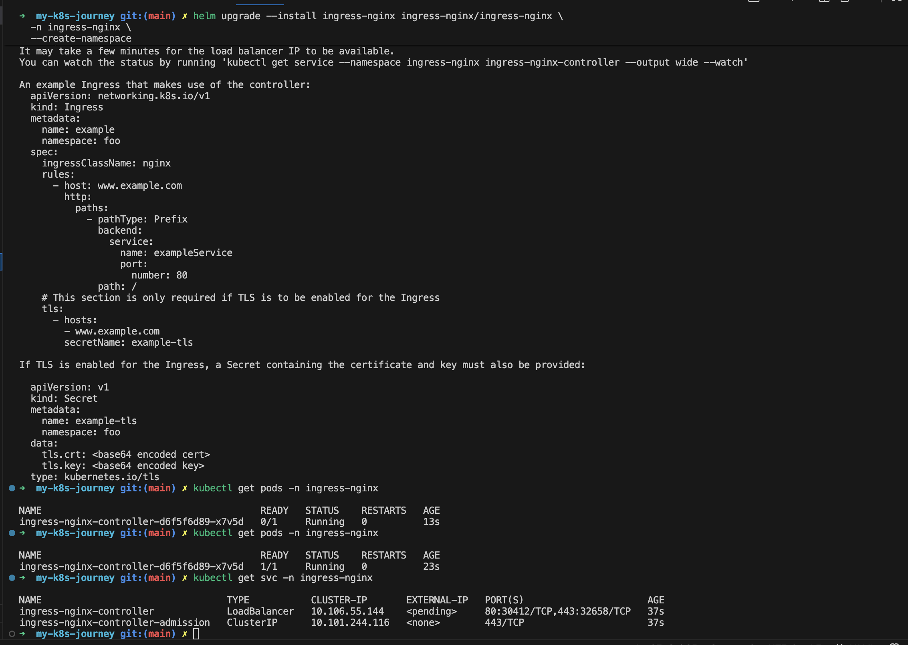
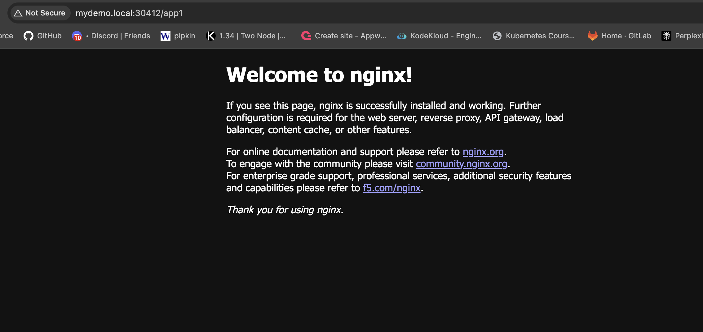
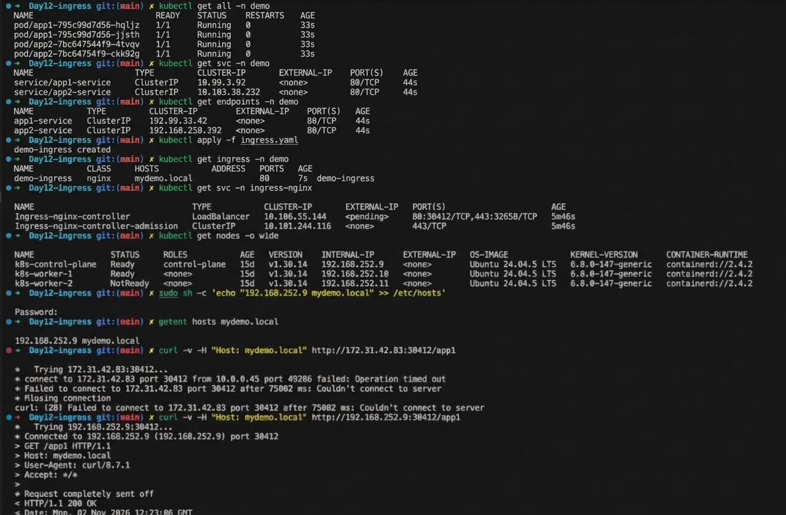

# Kubernetes Ingress with NGINX Ingress Controller (kubeadm Lab)

Route HTTP/HTTPS traffic from outside the cluster to multiple applications through one entry point, using an **Ingress** and the **NGINX Ingress Controller** on a kubeadm cluster.


## 1. What is Ingress?

An **Ingress** is an API object that defines rules for **HTTP/HTTPS traffic entering the cluster**.

| Feature | Example |
|---|---|
| **Path-based routing** | `/app1` goes to App1, `/app2` goes to App2 |
| **Host-based routing** | `myapp.example.com` goes to one application |
| **TLS termination** | HTTPS is handled at the Ingress layer |
| **Load balancing** | Traffic is distributed across backend Pods |
| **Central entry point** | Many applications behind one endpoint |

> **Important:** an Ingress object is **only a set of routing rules**. Nothing happens until an **Ingress Controller** (such as the NGINX Ingress Controller) is installed to implement those rules.

### Why not just use a Service of type LoadBalancer for each app?

| | One LoadBalancer Service per app | One Ingress |
|---|---|---|
| External load balancers | One per app (cost adds up) | One for all apps |
| Routing | Layer 4 (TCP/UDP) | Layer 7 (HTTP host and path) |
| TLS | Configured per app | Centralized |

---

## 2. How it works under the hood

```
 Client
   │  http://mydemo.local/app1
   ▼
 Node IP : NodePort (30472)                ← entry point on a kubeadm lab
   │  (kube-proxy forwards to the controller Pod)
   ▼
 ┌────────────────────────────────────────┐
 │ ingress-nginx-controller Pod           │
 │   nginx config is generated from       │
 │   the Ingress rules it watches         │
 └────────────────────────────────────────┘
   │  matches host + path
   ├──► /app1 ──► app1-service ──► app1 Pods (NGINX)
   └──► /app2 ──► app2-service ──► app2 Pods (Apache)
```

1. You create an **Ingress** object with routing rules.
2. The **Ingress Controller** watches the API server for Ingress objects and **generates its NGINX configuration** from them.
3. The controller itself is exposed to the outside world through a **Service** (LoadBalancer or NodePort).
4. A request arrives, the controller matches the **Host header and path**, and forwards it to the right backend. By default ingress-nginx sends traffic directly to the Pod endpoints behind the Service.

---

## 3. Prerequisites

### 3.1 Install Helm

```bash
curl -fsSL -o get_helm.sh https://raw.githubusercontent.com/helm/helm/main/scripts/get-helm-4
chmod 700 get_helm.sh
./get_helm.sh
```

> Check the script name in the Helm repository's `scripts/` folder if the download fails; the file name has changed between Helm major versions.

Verify:

```bash
helm version
```

### 3.2 Install the NGINX Ingress Controller

```bash
helm repo add ingress-nginx https://kubernetes.github.io/ingress-nginx
helm repo update

helm upgrade --install ingress-nginx ingress-nginx/ingress-nginx \
  -n ingress-nginx \
  --create-namespace
```

Verify:

```bash
kubectl get pods -n ingress-nginx
```

```
NAME                                        READY   STATUS
ingress-nginx-controller-xxxxxxxxxx-xxxxx   1/1     Running
```

Check the Service:

```bash
kubectl get svc -n ingress-nginx
```

```
NAME                      TYPE           CLUSTER-IP   EXTERNAL-IP   PORT(S)
ingress-nginx-controller  LoadBalancer   10.x.x.x     <pending>     80:30472/TCP,443:32201/TCP
```

> **Project status note:** the Kubernetes project announced the retirement of `ingress-nginx`, and Gateway API is the long-term direction. It still works for learning and the CKA-style concepts here, but check the current status before using it in production.

---

## 4. Why is EXTERNAL-IP pending?

On a vanilla **kubeadm** cluster there is no cloud provider integration, so Kubernetes **cannot create an AWS load balancer** for a `LoadBalancer` Service. It waits forever, so `EXTERNAL-IP` stays `<pending>`.



The Service still gets **NodePorts**, which we use in this lab:

```
HTTP  → 30472
HTTPS → 32201
```

Your NodePort numbers will be different. Always read them from `kubectl get svc`.

Alternatives for a real external IP on bare metal: **MetalLB**, or the AWS cloud controller manager with proper IAM and tags.

---

## 5. Step 1: Deploy demo applications

Two apps in the `demo` namespace:

- `app1` runs NGINX
- `app2` runs Apache HTTPD


```bash
kubectl apply -f apps.yaml
kubectl get all -n demo
kubectl get svc -n demo
kubectl get endpoints -n demo
```

You should see **endpoints for both Services**. If the endpoints are empty, the Service selector does not match the Pod labels.

---

## 6. Step 2: Create the Ingress resource

> **CKA point:** explicitly specify the **IngressClass**. Our controller uses `nginx`.


### Why the rewrite annotation?

The Ingress forwards the **full path** to the backend. Without a rewrite, NGINX receives a request for `/app1`, which does not exist in its default web root, and returns **404**. The rewrite strips `/app1` so the backend sees `/`.

If your apps already serve content under `/app1` and `/app2`, you can drop the annotations and use simple paths with `pathType: Prefix`.

```bash
kubectl apply -f ingress.yaml
kubectl get ingress -n demo
```

```
NAME           CLASS   HOSTS          ADDRESS   PORTS
demo-ingress   nginx   mydemo.local             80
```

The `ADDRESS` is empty on this lab because there is no external load balancer. That is expected.

```bash
kubectl describe ingress demo-ingress -n demo
```

Expected routing:

```
mydemo.local
  /app1 → app1-service:80
  /app2 → app2-service:80
```

---

## 7. Step 3: Find the Ingress NodePort

```bash
kubectl get svc -n ingress-nginx
```

Read the HTTP NodePort from `PORT(S)`: `80:<NodePort>/TCP`.

---

## 8. Step 4: Find the node IP

```bash
kubectl get nodes -o wide
```

Use the `INTERNAL-IP` (or the public IP, if you test from outside your network and the security group allows the NodePort). In the examples below the node IP is `192.168.252.9` and the NodePort is `30412`. **Replace both with your own values.**

---

## 9. Step 5: Configure /etc/hosts and test

Map the host name to the node IP (testing from the control-plane node):

```bash
sudo sh -c 'echo "192.168.252.9 mydemo.local" >> /etc/hosts'
getent hosts mydemo.local
```

The `hosts` file only maps a **name to an IP**. It cannot include a port, so you either add the port in the URL or send the `Host` header yourself.

### Test App1

Using the Host header (no `/etc/hosts` needed):

```bash
curl -v -H "Host: mydemo.local" http://192.168.252.9:30412/app1
```

Or using the host name and the NodePort:

```bash
curl -v http://mydemo.local:30412/app1
```

Expected:

```
HTTP/1.1 200 OK
```

### Test App2

```bash
curl -v -H "Host: mydemo.local" http://192.168.252.9:30412/app2
```

NGINX and Apache return different default pages, so you can tell which app answered.

### Prove that host-based routing matters

```bash
curl -i http://192.168.252.9:30412/app1
```

Without the right `Host` header this returns **404** from the controller's default backend, because no Ingress rule matches.

---

## 10. Optional: TLS

Create a self-signed certificate and Secret:

```bash
openssl req -x509 -nodes -days 365 -newkey rsa:2048 \
  -keyout tls.key -out tls.crt \
  -subj "/CN=mydemo.local/O=demo"

kubectl create secret tls demo-tls --cert=tls.crt --key=tls.key -n demo
```

Add this to the Ingress `spec`:

```yaml
  tls:
    - hosts:
        - mydemo.local
      secretName: demo-tls
```

Test over the HTTPS NodePort (`-k` skips verification for the self-signed certificate):

```bash
curl -vk --resolve mydemo.local:32201:192.168.252.9 https://mydemo.local:32201/app1
```

TLS terminates at the Ingress Controller, and traffic to the Pods is plain HTTP inside the cluster.

---

## 11. Troubleshooting

| Symptom | Likely cause | Check and fix |
|---|---|---|
| `EXTERNAL-IP <pending>` | No cloud load balancer on kubeadm | Use the NodePort or install MetalLB |
| `404 Not Found` from NGINX (default backend) | No rule matched (wrong Host header or path) | Send `-H "Host: mydemo.local"` and check `kubectl describe ingress` |
| `404` from the backend app | Path not rewritten | Add the rewrite annotation, or serve content at that path |
| `503 Service Temporarily Unavailable` | Service has no endpoints | `kubectl get endpoints -n demo`, then fix the selector and labels |
| Ingress has no effect | Wrong or missing `ingressClassName` | `kubectl get ingressclass` and set `ingressClassName: nginx` |
| `ADDRESS` empty | Normal on kubeadm without a load balancer | Test through the NodePort |
| Cannot connect to NodePort | Firewall or AWS security group | Allow the NodePort range (30000-32767) |
| Connection works on one node only | Testing against the wrong IP | NodePorts are open on **every** node |

Useful debugging commands:

```bash
kubectl describe ingress demo-ingress -n demo
kubectl logs -n ingress-nginx deploy/ingress-nginx-controller
kubectl get endpoints -n demo
kubectl get ingressclass
```

---


## 12. Interview questions

**1. What is an Ingress?**
An API object holding HTTP/HTTPS routing rules (host and path based) for traffic entering the cluster.

**2. Ingress vs Ingress Controller?**
The Ingress is only the rules. The controller (NGINX, Traefik, HAProxy, cloud controllers) reads those rules and implements them.

**3. Ingress vs LoadBalancer Service?**
A LoadBalancer Service exposes one service at Layer 4. One Ingress can route many services at Layer 7 behind a single entry point.

**4. Why is EXTERNAL-IP pending on kubeadm?**
There is no cloud provider integration to create a load balancer. Use NodePort or MetalLB.

**5. What is an IngressClass?**
It tells Kubernetes which controller should handle an Ingress (`ingressClassName: nginx`).

**6. What is TLS termination?**
HTTPS is decrypted at the Ingress Controller using a TLS Secret, and traffic continues to backend Pods over HTTP.

**7. What does a 503 from Ingress usually mean?**
The backend Service has no ready endpoints.

**8. What is the difference between `pathType` Exact, Prefix and ImplementationSpecific?**
`Exact` matches the exact path, `Prefix` matches by path segments, and `ImplementationSpecific` leaves matching to the controller (used above for regex paths).

---

## 13. CKA tips

- Create an Ingress quickly:
  ```bash
  kubectl create ingress demo-ingress -n demo --class=nginx \
    --rule="mydemo.local/app1*=app1-service:80" \
    --rule="mydemo.local/app2*=app2-service:80"
  ```
  (`*` creates a `Prefix` path.)
- Always check `kubectl get ingressclass` and set the class explicitly.
- A Service must exist **in the same namespace** as the Ingress.
- Debug order: Ingress, then Service, then Endpoints, then Pods.
- Useful commands:
  ```bash
  kubectl get ingress -A
  kubectl describe ingress <name> -n <ns>
  kubectl get endpoints -n <ns>
  ```

---

## 14. Key takeaways

- **Ingress = rules. Ingress Controller = the engine that applies them.** You need both.
- One Ingress can serve many apps through host and path routing (Layer 7).
- On kubeadm, `EXTERNAL-IP` stays `<pending>`. Use the **NodePort** (or MetalLB).
- `/etc/hosts` maps a name to an IP only. Add the NodePort in the URL or use the `Host` header.
- A `503` means no endpoints, a `404` means no matching rule or a missing path on the backend.
- Debug flow: Ingress, then Service, then Endpoints, then Pods.

> **Mental model:** Service = reach the Pods inside the cluster. Ingress = decide which Service gets each incoming HTTP request.

