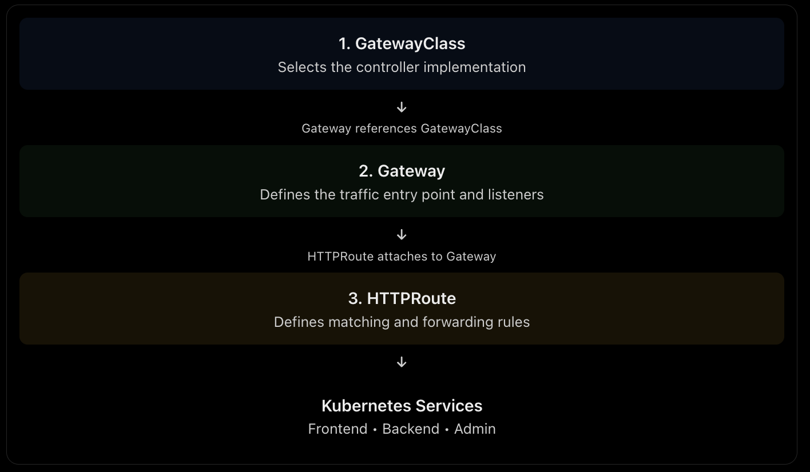
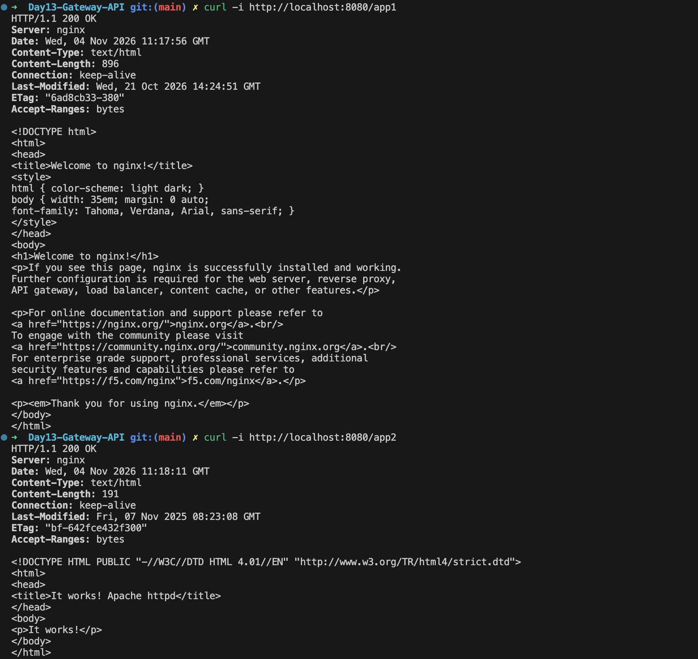
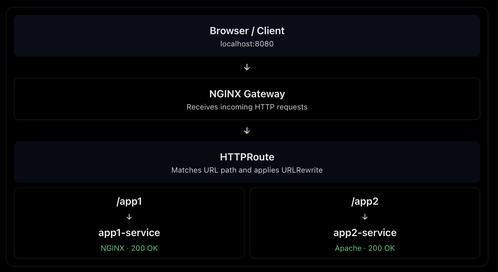

# Kubernetes Gateway API

## What is Gateway API?

**Kubernetes Gateway API** is a Kubernetes project that provides a standardized and extensible way to manage traffic entering a Kubernetes cluster.

It is a more flexible and expressive alternative to the traditional Kubernetes Ingress API.

Both Ingress and Gateway API help route external traffic to Kubernetes Services.



## 1. How Ingress Works

Ingress defines HTTP/HTTPS routing rules, such as routing traffic based on hostnames or URL paths.

```text
Internet
   |
   v
Ingress Controller (NGINX)
   |
   v
Ingress Resource
   |
   |--- /       → frontend-service
   |
   |--- /api    → backend-service
   |
   |--- /admin  → admin-service
```

Ingress works well for basic traffic routing.

However, advanced features such as traffic splitting, canary deployments, and custom policies often require controller-specific annotations.

This can make migration between different Ingress controllers more difficult.

## 2. What is Gateway API?

Gateway API provides a more structured way to configure Kubernetes traffic management.

Instead of putting everything into one Ingress resource, it separates configuration into different resources.

### Main Gateway API Resources

| Resource | Purpose |
|---|---|
| GatewayClass | Defines which Gateway controller manages the Gateway |
| Gateway | Defines the traffic entry point, listeners, ports, and TLS |
| HTTPRoute | Defines HTTP routing rules and backend Services |

## 3. How Gateway API Works

Gateway API separates infrastructure configuration from application routing.

```text
                 Control Plane
                 -------------
              GatewayClass
                    |
                    v
             Gateway Controller
                    |
          Watches and processes
          Gateway API resources
                    |
                    v
                  Gateway
                    |
                    v
                HTTPRoute


                  Data Plane
                  ----------
Internet / Client
       |
       v
Gateway Proxy (NGINX)
       |
       v
    HTTPRoute rules
       |
       |--- /       → frontend-service
       |
       |--- /api    → backend-service
       |
       |--- /admin  → admin-service
```

### Simple Explanation

- **GatewayClass:** Which Gateway implementation should manage the Gateway?
- **Gateway:** Where does traffic enter the cluster? It defines listeners, ports, protocols, and TLS configuration.
- **HTTPRoute:** Where should each HTTP request go?
- **Gateway Controller:** Watches Gateway API resources and configures the underlying proxy to implement the requested traffic management.

Gateway API is the overall API framework. GatewayClass, Gateway, and HTTPRoute are resources within that framework.

## 4. Real-World Example

Imagine a company running multiple applications in Kubernetes.

The platform team manages the shared Gateway:

- Public IP address or load balancer
- HTTPS/TLS certificates
- Listeners and ports
- Shared traffic entry point

Application teams manage their own HTTPRoutes:

- `/` → frontend
- `/api` → backend
- `/admin` → admin application

This separates infrastructure management from application routing.

## 5. Hands-On Implementation: NGINX Gateway Fabric

For this project, I installed NGINX Gateway Fabric and configured path-based routing to two backend applications.

### Project Architecture

```text
                  Client
                    |
                    v
             NGINX Gateway
                    |
                    v
                HTTPRoute
                    |
          +---------+---------+
          |                   |
          v                   v
       /app1                /app2
          |                   |
          v                   v
    app1-service         app2-service
          |                   |
          v                   v
     NGINX Pods          Apache Pods
       (2 replicas)        (2 replicas)
```

### Prerequisites

Before starting this project, make sure you have:

- Docker Desktop Kubernetes
- kubectl
- Helm
- Basic knowledge of Kubernetes Pods, Deployments, and Services

**My environment:**

- Kubernetes: v1.30.14
- NGINX Gateway Fabric: v2.4.2
- Helm
- Gateway API Standard CRDs

### Step 1: Install Gateway API CRDs

Gateway API CRDs define the Kubernetes resources required for Gateway API, including GatewayClass, Gateway, and HTTPRoute.

For compatibility with NGINX Gateway Fabric v2.4.2, I installed the matching Standard Gateway API CRDs:

```bash
kubectl kustomize \
  "https://github.com/nginx/nginx-gateway-fabric/config/crd/gateway-api/standard?ref=v2.4.2" \
  | kubectl apply -f -
```

### Step 2: Install NGINX Gateway Fabric

Install NGINX Gateway Fabric using its OCI Helm chart:

```bash
helm install nginx-gateway-fabric \
  oci://ghcr.io/nginx/charts/nginx-gateway-fabric \
  --version 2.4.2 \
  --namespace nginx-gateway \
  --create-namespace
```

**Version compatibility note:**

The latest chart I initially attempted to install required Kubernetes v1.32 or higher.

My local cluster was running Kubernetes v1.30.14, so I pinned the installation to version 2.4.2.

### Step 3: Verify the Installation

Check the controller Pod:

```bash
kubectl get pods -n nginx-gateway
```

Check the GatewayClass:

```bash
kubectl get gatewayclass
```

The NGINX Gateway Fabric Helm installation creates the GatewayClass automatically.

Verify its status:

```bash
kubectl describe gatewayclass nginx
```

Look for:

```text
Accepted: True
```

### Step 4: Create a Gateway

The Gateway defines the traffic entry point and HTTP listener.

Example `gateway.yaml`:


Apply the configuration:

```bash
kubectl apply -f gateway.yaml
```

Verify:

```bash
kubectl describe gateway demo-gateway -n demo
```

Check for:

- Accepted: True
- Programmed: True

### Step 5: Create an HTTPRoute

The HTTPRoute defines how incoming requests are forwarded to backend Services.

Example `httproute.yaml`:


Apply the configuration:

```bash
kubectl apply -f httproute.yaml
```

Verify:

```bash
kubectl get httproute -n demo
kubectl describe httproute demo-route -n demo
```

Look for:

- Accepted: True
- ResolvedRefs: True

**Important:** PathPrefix matches the original URL path. It does not automatically remove the prefix. The URLRewrite filter changes `/app1` or `/app2` to `/` before forwarding the request to the backend.

### Step 6: Verify Gateway and Route

```bash
kubectl get gateway -n demo
kubectl get httproute -n demo
```

The Gateway should show:

```text
PROGRAMMED: True
```

The HTTPRoute should show Accepted and ResolvedRefs conditions as True.

### Step 7: Test Application Traffic

For local Docker Desktop Kubernetes, the LoadBalancer external IP may remain pending.

I used kubectl port-forward to access the Gateway Service locally:

```bash
kubectl port-forward -n demo svc/demo-gateway-nginx 8080:80
```

Keep the port-forward process running.

Open another terminal and test both applications:

**Test app1:**

```bash
curl -i http://localhost:8080/app1
```

Expected response:

```text
HTTP/1.1 200 OK
Welcome to nginx!
```

**Test app2:**

```bash
curl -i http://localhost:8080/app2
```

Expected response:

```text
HTTP/1.1 200 OK
It works!
```

Both applications successfully returned HTTP 200 OK through the Gateway.





## 6. Troubleshooting and Issues Encountered

During the hands-on implementation, I encountered several issues and learned how to troubleshoot them.

| Issue | Root Cause | Resolution |
|---|---|---|
| Helm chart not found | Used the NGINX Ingress Helm repository instead of the Gateway Fabric chart | Switched to the official NGINX Gateway Fabric OCI chart |
| Kubernetes version incompatibility | Latest chart required Kubernetes v1.32+, while my cluster was v1.30.14 | Pinned NGINX Gateway Fabric to v2.4.2 |
| Controller CrashLoopBackOff | Required Gateway API CRDs, including GRPCRoute, were missing | Installed matching Gateway API Standard CRDs |
| GatewayClass immutable field error | Helm had already created a GatewayClass with a different controller name | Inspected and reused the existing Helm-managed GatewayClass |
| HTTP 404 through Gateway | The backend received `/app1`, but its default page was available at `/` | Added URLRewrite with ReplacePrefixMatch |
| localhost NodePort connection failed | Docker Desktop did not expose the NodePort on localhost | Used kubectl port-forward to access the Gateway Service |

## 7. Ingress vs Gateway API

| Feature | Ingress | Gateway API |
|---|---|---|
| Basic HTTP routing | Yes | Yes |
| Host/path routing | Yes | Yes |
| TLS support | Yes | Yes |
| Advanced traffic management | Often controller-specific | More standardized |
| Traffic splitting | Often controller-specific | Supported by HTTPRoute |
| Role separation | Limited | Better support |
| Portability | Can depend on annotations | Standard resources improve portability |

## 8. Does Gateway API Replace Ingress?

No. Ingress is still supported and useful.

**Use Ingress when:**

- The application needs basic HTTP/HTTPS routing.
- The existing controller meets your requirements.
- You want a simple configuration.

**Consider Gateway API when:**

- You need advanced traffic management.
- Multiple teams share a traffic entry point.
- You want clearer separation between platform and application configuration.
- You want more standardized routing configuration across implementations.

## 9. Important Concept

Gateway API is **not a Gateway Controller**.

It defines Kubernetes resources. A compatible controller is still required to implement them.

Examples include:

- NGINX Gateway Fabric
- Envoy Gateway
- Istio
- Supported cloud Gateway API implementations


## 10. Key Takeaways

- **GatewayClass:** Which controller manages the Gateway?
- **Gateway:** Where does traffic enter the cluster?
- **HTTPRoute:** Where should incoming requests go?
- **Gateway Controller:** Implements the configuration.
- **URLRewrite:** Modifies the request URL before forwarding.
- **Backend Service:** Distributes traffic to application Pods.

**Biggest Learning:** Gateway API separates traffic entry-point configuration from application routing, making Kubernetes traffic management more flexible and easier to organize across teams.

---

**Hands-on Result:** Successfully deployed NGINX Gateway Fabric, configured GatewayClass, Gateway, and HTTPRoute resources, implemented URL rewriting, and routed traffic to two different backend applications with HTTP 200 OK responses.