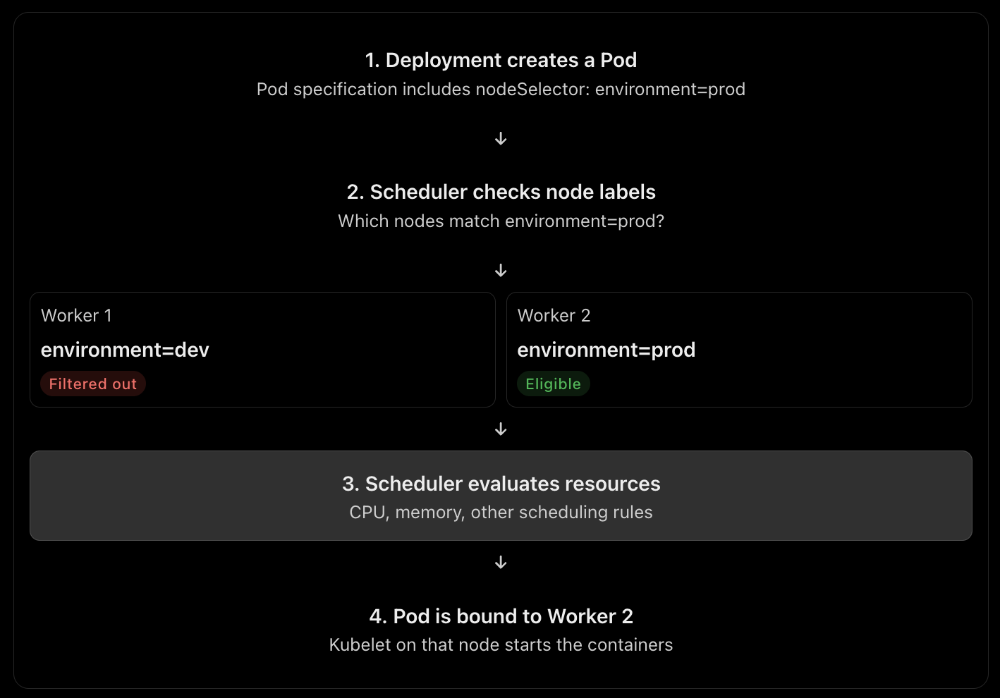
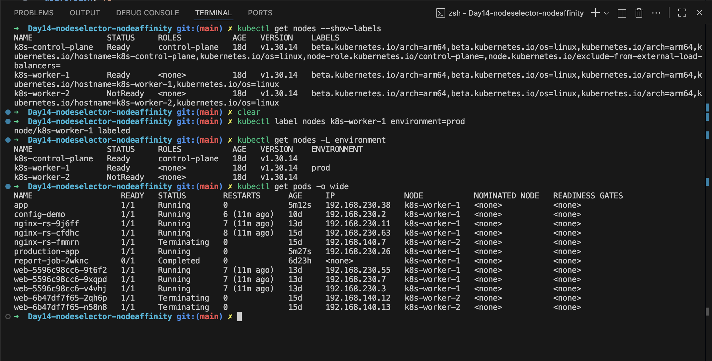

# Day 14 – Kubernetes Node Selector & Node Affinity

## 1. What is Node Selector?

A Node Selector is a Kubernetes scheduling mechanism that tells Kubernetes which worker nodes are suitable for running a Pod.

It uses **node labels**, which are key-value pairs assigned to Kubernetes nodes.

For example, a cluster might have:

- Worker 1: General workloads
- Worker 2: Production workloads
- Worker 3: GPU workloads

By using Node Selector, we can tell Kubernetes to schedule a Pod only on nodes with a specific label.

### Why do we need Node Selector?

By default, Kubernetes can schedule a Pod on any suitable worker node based on available resources and scheduling rules.

However, some workloads have specific requirements:

- An AI application needs a GPU.
- A database requires high-performance storage.
- A production application should run on production-designated nodes.
- A workload needs to run on a particular node group.

Node Selector helps control Pod placement based on these requirements.

## 2. How Node Selector Works Under the Hood

The main component responsible for Pod placement is the **kube-scheduler**.

When a Pod is created:

1. The Deployment or user creates a Pod through the Kubernetes API.
2. The API server stores the Pod specification in etcd.
3. The kube-scheduler detects that the Pod has not yet been assigned to a node.
4. The scheduler checks the Pod's scheduling requirements, including its Node Selector.
5. Nodes that do not match the required labels are filtered out.
6. The scheduler evaluates the remaining nodes based on available CPU, memory, and other scheduling rules.
7. The scheduler selects a suitable node and binds the Pod to it.
8. The kubelet on the selected node receives the Pod assignment.
9. The kubelet pulls the container image and starts the container.

### Important

Node Selector does not directly start a Pod or reserve a particular node.

It **filters the nodes that the scheduler is allowed to consider**.

If no node matches the required labels, the Pod remains in the `Pending` state.

## 3. Benefits of Node Selector

- Simple and easy to configure.
- Provides predictable Pod placement.
- Helps separate workloads across different node groups.
- Ensures workloads run on nodes with required hardware or labels.
- Useful for basic environment separation, such as development and production.
- Helps optimize resource usage by directing workloads to suitable nodes.

## 4. What is Node Affinity?

Node Affinity is an advanced Kubernetes scheduling mechanism that controls which nodes a Pod should or must run on.

It works similarly to Node Selector but provides more flexible rules and scheduling preferences.

Node Affinity has two main types:

### Required Node Affinity

`requiredDuringSchedulingIgnoredDuringExecution`

This is a **hard requirement**.

The Pod must be scheduled on a node that matches the specified rules.

If no suitable node exists, the Pod remains Pending.

Use it when a workload cannot run without a specific node characteristic.

Examples:
- A workload requires GPU-enabled nodes.
- An application must run on nodes with a specific hardware label.
- A workload must run within a designated group of nodes.

### Preferred Node Affinity

`preferredDuringSchedulingIgnoredDuringExecution`

This is a **soft requirement**.

Kubernetes tries to schedule the Pod on matching nodes, but it can use another suitable node if necessary.

The `weight` value influences how strongly the scheduler prefers a matching node.

For example, a higher weight gives that preference more influence during node scoring, but does not guarantee that node will be selected.

Use it when a workload should preferably run on certain nodes but can run elsewhere.

### Meaning of IgnoredDuringExecution

The scheduling rule is evaluated when the Pod is scheduled.

If a node's labels change after the Pod is running, Kubernetes does not automatically evict the Pod just because the affinity rule is no longer satisfied.

## 5. How Node Affinity Works Under the Hood

Node Affinity is processed by the kube-scheduler as part of its scheduling framework.

1. The scheduler identifies an unscheduled Pod.
2. It evaluates the Pod's Node Affinity rules against node labels.
3. For required affinity, nodes that do not match are filtered out.
4. For preferred affinity, matching nodes receive additional scoring.
5. The scheduler considers other requirements, including resource availability.
6. It selects the most suitable eligible node.
7. The Pod is bound to that node.
8. The kubelet starts the Pod's containers.

Required affinity determines which nodes are eligible, while preferred affinity influences which eligible node is selected.

## 6. Node Selector vs Node Affinity

| Feature | Node Selector | Node Affinity |
|---|---|---|
| Complexity | Simple | Flexible |
| Uses node labels | Yes | Yes |
| Exact key-value matching | Yes | Yes |
| Mandatory placement | Yes | Yes |
| Preferred placement | No | Yes |
| Advanced operators | No | Yes |
| Supports complex rules | No | Yes |
| Best for | Simple placement requirements | Advanced scheduling policies |

### Key Difference

**Node Selector:** The Pod must run on a node with the specified labels.

**Required Node Affinity:** The Pod must satisfy more flexible scheduling conditions.

**Preferred Node Affinity:** Kubernetes tries to place the Pod on matching nodes but can choose another suitable node.

## 7. Where Do We Use Node Selector and Node Affinity?

### GPU Workloads

AI and machine-learning applications may require GPU-enabled nodes.

Node Selector or required Node Affinity ensures these workloads are scheduled on nodes with the required GPU hardware.

### High-Performance Storage

Database or storage-intensive workloads may need nodes with SSD or NVMe storage.

Node labels can identify these nodes, allowing Kubernetes to schedule workloads accordingly.

### Production and Development Separation

Different node groups can be labeled for production and development workloads.

Scheduling rules can direct applications to their appropriate node groups.

### AWS EKS Node Groups

In AWS EKS, different managed node groups can use different EC2 instance types.

For example:

- General-purpose EC2 instances for normal applications.
- Memory-optimized instances for memory-intensive workloads.
- GPU instances for AI workloads.

Node Selector and Node Affinity can help schedule Pods onto the appropriate node groups.

### Availability Zone Preferences

Node Affinity can be used to prefer nodes in a particular Availability Zone or enforce placement requirements when necessary.

This can help optimize latency or meet workload placement requirements.

## 8. Node Selector and Node Affinity vs Taints and Tolerations

Node Selector and Node Affinity control **which nodes a Pod should or must run on**.

Taints and Tolerations control **which Pods are allowed to schedule onto a node**.

For example, if a GPU node group should be reserved for AI workloads:

- Node Selector or Node Affinity directs AI Pods to GPU nodes.
- A taint prevents ordinary Pods from scheduling onto those nodes.
- A toleration allows the AI Pods to tolerate that taint.

Using these together helps create dedicated node groups.

## 9. Key Takeaways

- Node Selector is the simplest way to control Pod placement using node labels.
- Node Affinity provides more advanced scheduling requirements and preferences.
- Required affinity is mandatory; preferred affinity is a preference.
- The kube-scheduler evaluates these rules before assigning a Pod to a node.
- The kubelet starts the containers after the Pod is assigned.
- These mechanisms are commonly used in production Kubernetes and AWS EKS environments.
- Node placement rules do not replace taints and tolerations when dedicated nodes are required.

## 10. Interview Answer

"Node Selector is a basic Kubernetes scheduling mechanism that uses node labels to control where Pods run. Under the hood, the kube-scheduler filters out nodes that do not match the selector, evaluates the remaining nodes based on resources and other scheduling rules, and binds the Pod to a suitable node.

Node Affinity provides more advanced scheduling capabilities, including mandatory requirements and soft preferences. I would use Node Selector for simple requirements, such as scheduling workloads on GPU nodes, and Node Affinity when I need flexible conditions, preferred Availability Zones, or more complex placement rules.

In production EKS environments, these mechanisms help place workloads on the appropriate EC2 node groups based on hardware, resources, and application requirements."

