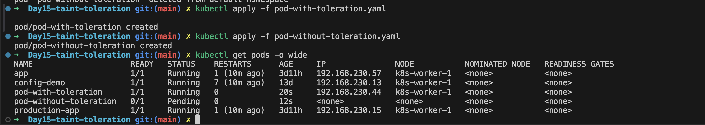
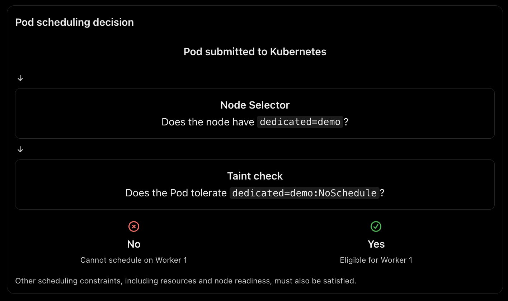

# Kubernetes Taints and Tolerations

## 1. What are Taints and Tolerations?

Taints and tolerations control which Pods can be scheduled onto particular Kubernetes nodes.

- **Taint:** Applied to a node to repel Pods that do not tolerate the taint.
- **Toleration:** Added to a Pod to allow it to be considered for scheduling onto a node with a matching taint.

**Important:** A toleration does not guarantee that a Pod will run on that node. It only removes the taint as a scheduling barrier.

## 2. Why Do We Need Them?

- Reserve nodes for specific workloads.
- Isolate GPU or database workloads.
- Prevent unrelated applications from using dedicated nodes.
- Control scheduling on unhealthy or maintenance nodes.
- Improve workload isolation in production clusters.

## 3. Types of Taint Effects

| Effect | Behavior |
|---|---|
| NoSchedule | Prevents new Pods without matching tolerations from scheduling onto the node. |
| PreferNoSchedule | Kubernetes tries to avoid placing non-tolerating Pods on the node. |
| NoExecute | Prevents new Pods and evicts existing Pods that don't tolerate the taint. |

### NoExecute and tolerationSeconds

A Pod can specify how long it may remain on a node after a matching NoExecute taint is applied.

Example:

```yaml
tolerations:
  - key: maintenance
    operator: Equal
    value: planned
    effect: NoExecute
    tolerationSeconds: 60
```

## 4. Taint Command Syntax

```bash
kubectl taint nodes <node-name> <key>=<value>:<effect>
```

Example:

```bash
kubectl taint nodes worker-1 dedicated=production:NoSchedule
```

Remove a taint:

```bash
kubectl taint nodes worker-1 dedicated=production:NoSchedule-
```

## 5. Taints vs. Tolerations

| Taints | Tolerations |
|---|---|
| Applied to Nodes | Defined in Pod specifications |
| Repel non-tolerating Pods | Allow matching taints to be tolerated |
| Control node access | Remove a scheduling barrier |
| Do not select a Pod | Do not guarantee node placement |

## 6. Other Kubernetes Scheduling Mechanisms

| Feature | Purpose |
|---|---|
| Node Selector | Select nodes using labels |
| Node Affinity | Apply advanced node placement rules |
| Pod Affinity | Schedule Pods close to other Pods |
| Pod Anti-Affinity | Keep Pods away from other Pods |
| Taints | Repel unwanted Pods |
| Tolerations | Allow Pods to tolerate matching taints |

## 7. Hands-on Lab

### Objective

Reserve a worker node using a taint and allow only Pods with matching tolerations to schedule onto it.

### Step 1: Check nodes

```bash
kubectl get nodes
```

### Step 2: Label a node

```bash
kubectl label nodes <node-name> lab=taint-demo
```

### Step 3: Apply a taint

```bash
kubectl taint nodes <node-name> dedicated=demo:NoSchedule
```

### Step 4: Create a Pod without toleration


```bash
kubectl apply -f pod-without-toleration.yaml
```

Expected result: Pod remains Pending because it does not tolerate the node taint.


### Step 5: Create a Pod with toleration


```bash
kubectl apply -f pod-with-toleration.yaml
```

Expected result: Pod gets scheduled onto the selected node, assuming sufficient resources.

### Step 6: Verify

```bash
kubectl get pods -o wide
kubectl describe pod pod-without-toleration
kubectl describe pod pod-with-toleration
```

Check the Events section to understand the scheduler's decision.



### Step 7: Cleanup

```bash
kubectl delete pod pod-without-toleration pod-with-toleration

kubectl taint nodes <node-name> dedicated=demo:NoSchedule-

kubectl label nodes <node-name> lab-
```

## 8. Real-World Production Example

Imagine an organization has GPU-enabled worker nodes for machine-learning workloads.

1. Apply a taint to GPU nodes.
2. General application Pods without tolerations cannot schedule there.
3. Machine-learning Pods have matching tolerations.
4. Node affinity ensures those Pods select GPU-enabled nodes.

This prevents unrelated applications from consuming specialized infrastructure.

## 9. Interview Questions

**Q1. What is the difference between a taint and a toleration?**

A taint is applied to a node to repel Pods, while a toleration is added to a Pod to allow it to tolerate a matching taint.

**Q2. Does a toleration guarantee that a Pod runs on a particular node?**

No. It only removes the taint restriction. Other scheduling rules still apply.

**Q3. What is the difference between NoSchedule and NoExecute?**

NoSchedule prevents new non-tolerating Pods from scheduling. NoExecute also evicts existing non-tolerating Pods.

**Q4. How do you reserve nodes for specific workloads?**

Apply taints to the nodes, add matching tolerations to the intended Pods, and use node selectors or node affinity to direct those Pods to the reserved nodes.

**Q5. Can taints and node affinity be used together?**

Yes. Taints repel unwanted workloads, while node affinity selects the intended nodes.

---

**Key takeaway:** Taints and tolerations control which Pods can tolerate a node, while selectors and affinity rules control where Pods should run.
