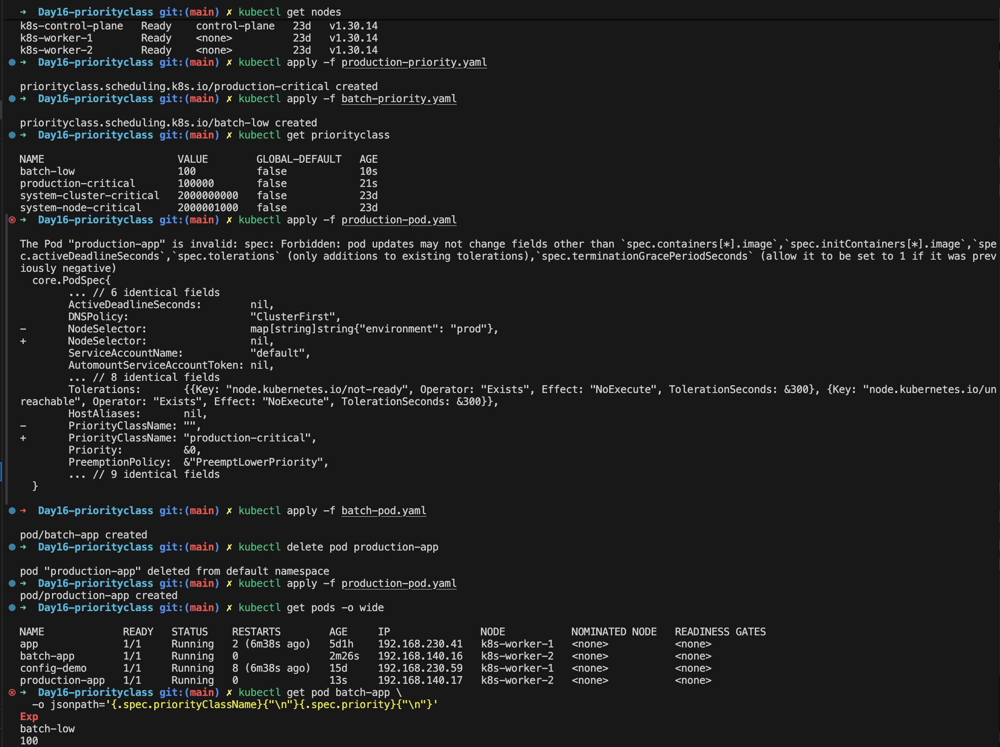

# Day 16: Kubernetes PriorityClass

## What is a PriorityClass?

A **PriorityClass** is a cluster-level Kubernetes object that assigns a **priority value** to Pods. The scheduler uses this value to decide which Pods to consider first when resources are constrained.

It helps separate critical workloads from less important ones:

| Level | Examples |
|---|---|
| **Critical** | Production APIs, DNS services, essential infrastructure components |
| **Important** | Monitoring agents, application backends |
| **Low priority** | Batch jobs, development environments, nonessential tasks |

> A PriorityClass does **not** reserve CPU or memory. It only influences **scheduling order** and whether lower-priority Pods may be **preempted** to make room.

---

## Why do we need PriorityClasses?

- **Production reliability:** critical workloads get higher scheduling priority.
- **Resource contention:** helps the scheduler decide which pending Pod to consider first.
- **Workload classification:** distinguishes production services from background jobs.
- **Preemption:** lets higher-priority Pods displace lower-priority Pods when necessary.
- **Cluster resource management:** consistent priority policy across teams and namespaces.

---

## How PriorityClasses work under the hood

A PriorityClass maps a **name** to an **integer value**. A higher number means higher priority.

1. You create a **PriorityClass** (for example `production-critical`, value `100000`).
2. You set `priorityClassName` on a Pod, or on a Deployment's Pod template.
3. When the Pod is created, the **Priority admission controller** looks up that class and writes the number into the Pod's `spec.priority`. The Pod now carries the integer itself.
4. The **kube-scheduler** keeps pending Pods in a queue ordered by priority, so higher-priority Pods are tried first.
5. If a high-priority Pod fits on no node, the scheduler may try **preemption**.

```
PriorityClass (name + value)  ──►  Pod.spec.priorityClassName  ──►  Pod.spec.priority (number)
```

The `priority` on a Pod is set at **creation** and can't be edited afterward. Changing or adding a PriorityClass later does **not** update Pods that already exist.

### How preemption works

```
High-priority Pod is Pending (no node has enough free resources)
        │
        ▼
Scheduler looks for a node where evicting LOWER-priority Pods
would make room for it
        │
        ▼
Chosen victim Pods are gracefully terminated
        │
        ▼
The Pod is marked with a "nominated node" and scheduled once space is free
```

- Only Pods with **lower** priority than the pending Pod can be victims.
- The scheduler tries to **respect PodDisruptionBudgets**, but this is best effort, not a guarantee.
- Victims get their normal **termination grace period**, so the high-priority Pod may wait a little.
- Preemption only happens if it would actually **make the Pod schedulable**. If evicting Pods wouldn't help (wrong node labels, taints and so on), nothing is evicted.
- **Priority does not guarantee that a Pod will run.** Resource requests, node selectors, taints and other constraints still apply.

---

## PriorityClass vs Pod priority vs resource requests

| | What it is | What it does |
|---|---|---|
| **PriorityClass** | Cluster-level object (name + value) | Defines a reusable priority level |
| **Pod priority** | `spec.priority` on the Pod | The number the scheduler actually compares |
| **Resource requests** | CPU and memory a Pod asks for | What the scheduler must fit on a node |

Priority decides *who goes first when there is competition*. Requests decide *what has to fit*.

---

## Lab files

This lab uses the manifests already in this folder, so they are not repeated here:

| File | Purpose |
|---|---|
| `production-priority.yaml` | High-priority class `production-critical`, value `100000` |
| `batch-priority.yaml` | Low-priority class `batch-low`, value `100` |
| `production-pod.yaml` | Pod `production-app` using `production-critical` |
| `batch-pod.yaml` | Pod `batch-app` using `batch-low` |

The values `100000` and `100` are examples for this lab, not Kubernetes-reserved numbers.

---

## Step 1: Check the cluster

```bash
kubectl get nodes
kubectl get pods -A
kubectl get priorityclass
```

Kubernetes already includes built-in classes such as `system-cluster-critical` and `system-node-critical`. **Do not modify or delete them.** They use very high values reserved for system components, and user-defined classes must stay below that range.

## Step 2: Create the high-priority class

```bash
kubectl apply -f production-priority.yaml
kubectl get priorityclass
kubectl describe priorityclass production-critical
```

Fields to notice in the output:

- **`value`**: the numeric priority given to Pods that use this class.
- **`globalDefault: false`**: Pods without an explicit class do not inherit it.
- **`description`**: documents the purpose of the class.

## Step 3: Create the low-priority class

```bash
kubectl apply -f batch-priority.yaml
kubectl get priorityclass
```

Expected:

| PriorityClass | Value |
|---|---|
| production-critical | 100000 |
| batch-low | 100 |

## Step 4: Deploy the high-priority Pod

```bash
kubectl apply -f production-pod.yaml
kubectl get pod production-app
kubectl get pod production-app \
  -o jsonpath='{.spec.priorityClassName}{"\n"}{.spec.priority}{"\n"}'
```

Expected output:

```
production-critical
100000
```

The Pod's priority is **derived from its PriorityClass**.

## Step 5: Deploy the low-priority Pod

```bash
kubectl apply -f batch-pod.yaml
kubectl get pods -o wide
kubectl get pod batch-app \
  -o jsonpath='{.spec.priorityClassName}{"\n"}{.spec.priority}{"\n"}'
```

Expected output:

```
batch-low
100
```




Both Pods will normally run, because the cluster has enough resources. **A low-priority Pod is not evicted just because a high-priority Pod exists.**

## Step 6: Understand preemption

Preemption happens only when a high-priority Pod **cannot be scheduled** and evicting lower-priority Pods would make room for it.

```bash
kubectl describe pod production-app
kubectl get events --sort-by=.metadata.creationTimestamp
```

In this lab resources are not exhausted, so **preemption will not occur**. To see it you would need a test cluster with deliberately constrained capacity: low-priority Pods that fill a node, then a high-priority Pod that cannot fit. The events would then show the low-priority Pods being preempted and the high-priority Pod being scheduled.

> **Warning:** never deliberately exhaust resources or test preemption on a shared or production cluster.

---

## Global default priority

A PriorityClass with `globalDefault: true` becomes the default for Pods that don't set `priorityClassName`.

- Only **one** PriorityClass should be the global default.
- If none is set, Pods without a class get priority **0**.
- It applies only to **newly created** Pods. Existing Pods keep their current priority.

> **Best practice:** assign classes explicitly to important workloads. Set a cluster-wide default only after reviewing how it affects existing applications.

---

## preemptionPolicy

A PriorityClass supports a `preemptionPolicy` field:

| Value | Behavior |
|---|---|
| **`PreemptLowerPriority`** (default) | The Pod may preempt lower-priority Pods if necessary |
| **`Never`** | The Pod keeps its high scheduling priority but **never evicts other Pods** |

`Never` suits a workload that should be considered **before** lower-priority pending Pods but must not disrupt Pods that are already running, such as large batch jobs. A Pod with `Never` can still stay **Pending** if resources are insufficient.

---

## Priority vs QoS vs node-pressure eviction

These are easy to confuse:

| Mechanism | Decided by | When it applies |
|---|---|---|
| **Pod priority** | PriorityClass | Scheduling order and scheduler preemption |
| **QoS class** (Guaranteed, Burstable, BestEffort) | Resource requests and limits | Which Pods the **kubelet** evicts first when a node runs out of resources |

Scheduler preemption is about *getting a Pod placed*. Node-pressure eviction is about *protecting a node that is already running out of resources*, and it is driven mainly by QoS and usage.

---

## Common issues

| Symptom | Likely cause |
|---|---|
| `PriorityClass not found` | The class doesn't exist. Check `kubectl get priorityclass` and create it **before** the Pod. |
| Pod stays `Pending` | Priority can't overcome insufficient resources, taints or node selectors |
| Low-priority Pod still running | Preemption isn't triggered just because a higher-priority Pod exists |
| Unexpected Pod eviction | Review priority values and `preemptionPolicy` |
| Priority has no effect on capacity | A PriorityClass doesn't reserve CPU or memory |
| Global default behaves unexpectedly | Check whether a `globalDefault` class exists and how it affects Pods without a class |
| Can't change a Pod's priority | `spec.priority` is set at creation. Recreate the Pod with the new class. |
| Can't change a class's `value` | The value is immutable. Create a new class and migrate the workloads. |

---

## Verification and cleanup

```bash
kubectl get priorityclass
kubectl get pods -o wide
kubectl get pod production-app \
  -o jsonpath='{.metadata.name}{" priority="}{.spec.priority}{" class="}{.spec.priorityClassName}{"\n"}'
kubectl get pod batch-app \
  -o jsonpath='{.metadata.name}{" priority="}{.spec.priority}{" class="}{.spec.priorityClassName}{"\n"}'
```

Clean up:

```bash
kubectl delete pod production-app batch-app --ignore-not-found
kubectl delete priorityclass production-critical batch-low
```

If you created any optional classes (a default class or a no-preemption class), delete them too after confirming no workload uses them.

---

## Interview questions

**1. What is a PriorityClass in Kubernetes?**
A cluster-level object that defines a priority value for Pods.

**2. How does Kubernetes use Pod priority?**
The scheduler considers priority when deciding which pending Pods to schedule first, and may preempt lower-priority Pods when necessary.

**3. Does a high-priority Pod always run first?**
No. Priority influences scheduling order, but resource availability and scheduling constraints still apply.

**4. What is preemption?**
Evicting lower-priority Pods to make room for a higher-priority Pod when that is feasible.

**5. How is priority different from resource requests?**
Priority influences scheduling order and potential preemption. Requests describe the resources a Pod asks the scheduler to fit.

**6. What does `globalDefault` mean?**
It makes that PriorityClass the default for Pods that don't specify `priorityClassName`.

**7. What is `preemptionPolicy: Never`?**
It stops a Pod from preempting others, even though it can still have a higher scheduling priority.

**8. Can a PriorityClass reserve CPU or memory?**
No. Use resource requests, limits and capacity management for that.

**9. How does a Pod get its priority number?**
The Priority admission controller resolves `priorityClassName` and writes the value into `spec.priority` when the Pod is created.

**10. What is the difference between scheduler preemption and kubelet eviction?**
Scheduler preemption makes room to place a pending high-priority Pod. Kubelet eviction protects a node under resource pressure and is driven mainly by QoS and usage.

---

## Key Takeaways

- PriorityClasses define reusable scheduling priorities for Kubernetes Pods.
- Higher-priority Pods are considered ahead of lower-priority pending Pods.
- Preemption may free resources by evicting lower-priority Pods.
- Priority does not reserve CPU or memory and cannot guarantee successful scheduling.
- `preemptionPolicy: Never` disables scheduler preemption for Pods using that class.
- Use priority levels carefully to protect critical workloads without unnecessarily disrupting other applications.