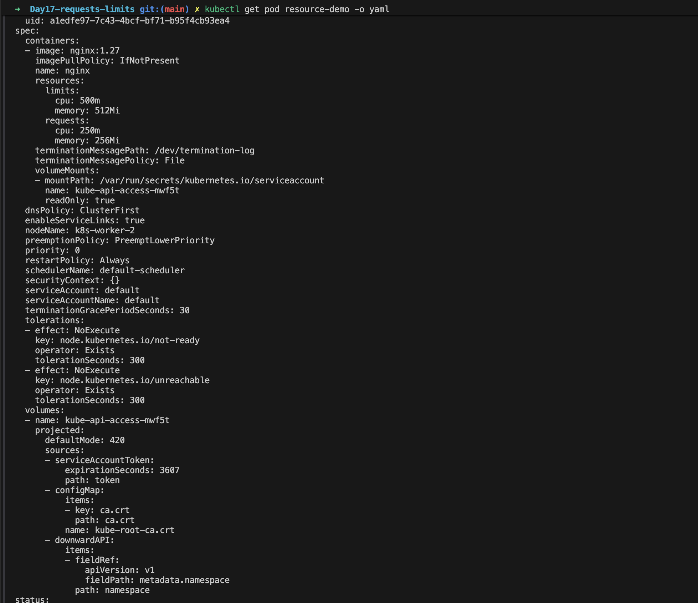

# Day 17 – Kubernetes Resource Requests and Limits

## What are Resource Requests and Limits?

**Resource Requests and Limits** define how much CPU and memory a container needs and how much it is allowed to consume.

Kubernetes uses requests when making Pod scheduling decisions and enforces limits to control container resource consumption.

- **Requests** → The amount of CPU or memory Kubernetes accounts for when deciding whether a node has enough resources to schedule a Pod.
- **Limits** → The maximum CPU or memory a container is allowed to consume.

## Why Do We Need Resource Requests and Limits?

- **Efficient scheduling** → Help Kubernetes place Pods on nodes with sufficient available resources.
- **Resource isolation** → Reduce the risk of one workload consuming excessive resources.
- **Application stability** → Help prevent memory exhaustion and resource contention.
- **Capacity planning** → Estimate how many workloads a cluster can support.
- **Cost optimization** → Improve resource utilization and reduce unnecessary overprovisioning.
- **Autoscaling** → Provide the resource requests used by CPU-based Horizontal Pod Autoscaler utilization targets.

## Understanding Requests vs. Limits

### Requests

Requests tell Kubernetes how much CPU and memory a container is expected to need.

When scheduling a Pod, the scheduler considers the resource requests of its containers and checks whether a suitable node has enough allocatable resources.

A request is **not a hard usage cap**. A container may use more than its request when resources are available, subject to its limits and node conditions.

### Limits

Limits define the maximum resource consumption allowed for a container.

CPU and memory behave differently when a container reaches its limit:

- **CPU limit** → CPU usage is throttled. The container is not terminated simply for reaching its CPU limit.
- **Memory limit** → If the container exceeds its memory limit, it can be terminated by the kernel's out-of-memory (OOM) mechanism.

## Understanding CPU Units

Kubernetes measures CPU in cores or millicores.

| CPU value | Meaning |
|---|---|
| `1` | 1 CPU core |
| `500m` | 0.5 CPU core |
| `250m` | 0.25 CPU core |
| `100m` | 0.1 CPU core |

Example:

```yaml
resources:
  requests:
    cpu: "250m"
  limits:
    cpu: "500m"
```

This container requests one-quarter of a CPU core for scheduling and can use up to half a CPU core before CPU throttling applies.

## Understanding Memory Units

Kubernetes commonly uses binary memory units.

| Memory value | Meaning |
|---|---|
| `128Mi` | 128 mebibytes |
| `256Mi` | 256 mebibytes |
| `512Mi` | 512 mebibytes |
| `1Gi` | 1 gibibyte |

Example:

```yaml
resources:
  requests:
    memory: "256Mi"
  limits:
    memory: "512Mi"
```

The scheduler uses the 256Mi request when evaluating node capacity. If the container exceeds its 512Mi memory limit, it can be terminated due to an OOM condition.

## Hands-On: Configure Requests and Limits

Create a file named `resource-pod.yaml`:


### Apply the configuration

```bash
kubectl apply -f resource-pod.yaml
```

### Check the Pod

```bash
kubectl get pods
kubectl describe pod resource-demo
```

### Inspect configured resources

```bash
kubectl get pod resource-demo -o yaml
```

### Check actual resource usage

```bash
kubectl top pod resource-demo
```

Note: `kubectl top` requires Metrics Server to be installed and working.

## How It Works Under the Hood

1. A Pod is submitted with resource requests and limits.
2. The scheduler checks the node's allocatable resources against the Pod's resource requests.
3. If a suitable node has enough available capacity, the Pod can be scheduled there.
4. The container runtime and Linux kernel enforce resource constraints, commonly through Linux control groups (cgroups).
5. CPU usage is throttled when the CPU limit is reached.
6. Memory usage exceeding the memory limit can trigger an OOM kill.

## Important Things to Remember

- Requests influence scheduling; limits control maximum resource consumption.
- Requests are not hard caps.
- CPU limits cause throttling, not automatic container termination.
- Memory limits can cause OOM termination.
- A memory request is not a guaranteed physical memory allocation.
- Kubernetes schedules based on resource requests, not simply the container's current usage.
- Resource requests and limits are configured per container.

## Key Takeaway

**Requests help Kubernetes decide where a Pod can run. Limits help control how much CPU and memory its containers can consume.**

Proper resource configuration helps applications run reliably, improves cluster utilization, and prevents workloads from consuming more resources than intended.

#Kubernetes #DevOps #CloudComputing #SRE #LearningInPublic

