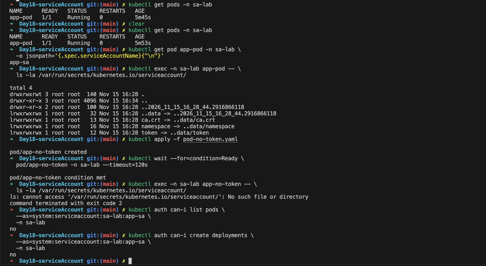

# Day 18: Kubernetes Service Accounts

## 1. What is a Service Account?

A **Service Account** provides an **identity for processes running inside a Kubernetes cluster**. An application running in a Pod can use this identity to authenticate to the Kubernetes API server.

Example: you deploy an application that needs to read information about Pods from the Kubernetes API. Instead of using a human user's credentials, the application uses a Service Account.

Service Accounts are **namespaced API objects**.

### Real-world use cases

- Letting applications communicate with the Kubernetes API.
- Giving monitoring agents access to specific Kubernetes resources.
- Letting automation tools perform cluster operations.
- Providing workload identity for applications that talk to external cloud services, when integrated with the relevant cloud identity system (for example IAM roles for Service Accounts on EKS).

---

## 2. Why do we need Service Accounts?

Say an application in a Pod needs to list Pods in its namespace. Without a suitable identity and authorization configuration, it can't do that through the Kubernetes API.

A Service Account **identifies** the workload. RBAC (Role-Based Access Control) decides what that identity is **allowed to do**.

| Concept | Question it answers |
|---|---|
| **Service Account** | Who is the workload? |
| **RBAC** | What is the workload allowed to do? |
| **Authentication** | Is the workload's identity valid? |
| **Authorization** | Is that identity permitted to perform the requested action? |


---

## 3. Service Account vs User Account

Kubernetes has **no built-in `User` API object**. Human users come from outside the cluster (client certificates, an OIDC identity provider, a cloud IAM integration). Service Accounts are real Kubernetes objects.

| | User account | Service Account |
|---|---|---|
| For | Humans (admins, developers) | Workloads and processes (Pods) |
| Stored as a Kubernetes object | No | Yes (namespaced) |
| Managed by | An external identity system | Kubernetes |
| Credential | Certificate, OIDC token, etc. | Signed token (JWT) issued by the API server |
| Scope | Cluster-wide identity | Belongs to one namespace |

---

## 4. How it works under the hood

### 4.1 From Pod creation to a working token

```
1. You create a Pod (serviceAccountName: app-sa, or none)
        │
2. ServiceAccount admission controller:
        │   - fills in "default" if no Service Account was set
        │   - adds a projected volume for the token (unless automount is off)
        ▼
3. Kubelet on the node asks the API server for a token (TokenRequest API)
        ▼
4. Token is mounted into the container at
   /var/run/secrets/kubernetes.io/serviceaccount/
        ▼
5. The app sends the token with each API request
   (Authorization: Bearer <token>)
```

### 4.2 What the API server does with a request

```
Request + token
   │
   ▼
Authentication   Is the token valid? (signature, expiry, audience, Pod still exists)
   │             → identity: system:serviceaccount:<namespace>:<name>
   ▼
Authorization    Does RBAC allow this identity to do this action?
   │
   ▼
Admission        Policy checks and mutation
   │
   ▼
Allowed, or rejected
```

- **401 Unauthorized:** authentication failed (bad or expired token).
- **403 Forbidden:** authentication worked but **RBAC doesn't allow** the action. 

### 4.3 The token

Modern Kubernetes uses **projected, bound tokens**, not the old permanent Secret tokens:

| Old style (legacy) | Modern (projected) |
|---|---|
| A long-lived token stored in a Secret | A short-lived token requested by the kubelet |
| Valid until the Secret is deleted | Expires and is **refreshed automatically** |
| Not tied to a Pod | **Bound to the Pod**, invalid once the Pod is deleted |
| Auto-created for every Service Account | Not auto-created in current versions |

That is why `SECRETS` shows `0` for a Service Account on a modern cluster. It is normal.

Every Service Account identity looks like this to the API server:

```
Username: system:serviceaccount:sa-lab:app-sa
Groups:   system:serviceaccounts
          system:serviceaccounts:sa-lab
```

You will use this exact string when granting permissions in RBAC and when testing with `--as`.

---

## 5. The default Service Account

When a namespace is created, Kubernetes normally creates a Service Account named **`default`** in it. A Pod created **without** a Service Account uses the namespace's `default` one.

### Step 1: List namespaces

```bash
kubectl get namespaces
```

### Step 2: List Service Accounts

```bash
kubectl get serviceaccounts -n default
```

`SECRETS` showing `0` is normal on modern Kubernetes (see 4.3).

### Step 3: Describe the default Service Account

```bash
kubectl describe serviceaccount default -n default
```

This shows the namespace, image pull secrets (if configured) and token information.

> **Important:** the `default` Service Account is **not** an administrator identity. Its permissions depend on the cluster's authorization configuration, and by default it has no useful API permissions.

---

## 6. Create a custom Service Account

In production, create a **dedicated Service Account per application** instead of relying on `default`. That way each application can get only the permissions it needs, and you can see which workload did what.

```bash
kubectl create namespace sa-lab
kubectl create serviceaccount app-sa -n sa-lab
kubectl get serviceaccounts -n sa-lab
kubectl describe serviceaccount app-sa -n sa-lab
```

You now have a custom identity for workloads in the `sa-lab` namespace.

---

## 7. Use a Service Account in a Pod

Creating a Service Account does **not** make any Pod use it. You must set it in the Pod spec.


```bash
kubectl apply -f pod.yaml
kubectl get pods -n sa-lab
kubectl get pod app-pod -n sa-lab \
  -o jsonpath='{.spec.serviceAccountName}{"\n"}'
```

The last command prints `app-sa`, which confirms the Pod uses it.

> **Key point:** setting a Service Account gives the Pod a **workload identity**. It does **not** give that identity permission to list, create, update or delete anything.

Notes:

- A running Pod's `serviceAccountName` **cannot be changed**. Recreate the Pod (or update the Deployment's template, which triggers a rollout).
- The Service Account must exist in the **same namespace** as the Pod. Otherwise the Pod is rejected.

---

## 8. Verify the Service Account inside a Pod

When token automounting is enabled, Kubernetes makes a projected Service Account token available to the Pod.

```bash
kubectl exec -n sa-lab app-pod -- \
  ls -la /var/run/secrets/kubernetes.io/serviceaccount/
```

The directory normally contains:

```
ca.crt       the cluster CA certificate, used to trust the API server
namespace    the Pod's namespace
token        the credential
```

Safe to print:

```bash
kubectl exec -n sa-lab app-pod -- \
  cat /var/run/secrets/kubernetes.io/serviceaccount/namespace
```

> **Security:** the `token` file is a credential. **Never print it** in shared logs, screenshots or public repositories (including your GitHub repo and LinkedIn posts).

### What if the token is not mounted?

Mounting may be turned off in the Pod spec or on the Service Account with:

```
automountServiceAccountToken: false
```

If both are set, the **Pod setting wins**.

---

## 9. Disable automatic token mounting

Not every application needs the Kubernetes API. An NGINX container serving static content, for example, doesn't. If a Pod has no token, a compromised container has no credential to use against the API.


```bash
kubectl apply -f pod-no-token.yaml
kubectl wait --for=condition=Ready pod/app-no-token -n sa-lab --timeout=120s
kubectl exec -n sa-lab app-no-token -- \
  ls -la /var/run/secrets/kubernetes.io/serviceaccount/
```

The token files should **not** be there. If the directory doesn't exist, `ls` reports that it can't access the path. That is the expected result.

> This disables **automatic Service Account credential mounting** for this Pod. It does not stop an application from getting credentials through other means.

---

## 10. Test Service Account permissions

A Service Account is an identity. Its permissions come from the cluster's authorization configuration.

```bash
kubectl auth can-i list pods \
  --as=system:serviceaccount:sa-lab:app-sa \
  -n sa-lab
```

In a typical cluster where `app-sa` has no extra permissions:

```
no
```

```bash
kubectl auth can-i create deployments \
  --as=system:serviceaccount:sa-lab:app-sa \
  -n sa-lab
```

```
no
```

See everything the identity can do in the namespace:

```bash
kubectl auth can-i --list \
  --as=system:serviceaccount:sa-lab:app-sa \
  -n sa-lab
```


These commands use **impersonation**, so your own user needs permission to impersonate Service Accounts (a kubeadm admin normally has it). If you get an impersonation or authorization error, check your own access first.

### Why this matters

A workload should get **only the permissions it needs**. A Service Account alone is not a permission grant.

### Optional preview: grant a permission

Day 30 covers RBAC properly. As a quick preview, you can grant read access to Pods and watch the answer change:

```bash
kubectl create role pod-reader --verb=get,list --resource=pods -n sa-lab
kubectl create rolebinding app-sa-pod-reader \
  --role=pod-reader \
  --serviceaccount=sa-lab:app-sa \
  -n sa-lab

kubectl auth can-i list pods \
  --as=system:serviceaccount:sa-lab:app-sa -n sa-lab        # yes
kubectl auth can-i create deployments \
  --as=system:serviceaccount:sa-lab:app-sa -n sa-lab        # still no
```

The Role defines **what** is allowed, the RoleBinding connects it to **who** (the Service Account).

---

## 11. Best practices

- Create a **dedicated Service Account per application**. Avoid using `default`.
- Set **`automountServiceAccountToken: false`** for Pods that don't need the API.
- Grant **least privilege**. Never bind a workload's Service Account to `cluster-admin` for convenience.
- **Never print or commit tokens.**
- For a short-lived token for testing, use `kubectl create token app-sa -n sa-lab` instead of creating long-lived Secrets.
- For cloud access (such as AWS from EKS), use the cloud's workload identity integration rather than storing static cloud keys in Secrets.

---

## 12. Common issues

| Symptom | Likely cause |
|---|---|
| Pod rejected: Service Account not found | The Service Account doesn't exist in the Pod's namespace. Create it first. |
| `403 Forbidden` from the API | The identity is valid but has no RBAC permission for that action |
| `401 Unauthorized` | Missing, expired or invalid token |
| No `token` file in the Pod | Automount is disabled on the Pod or the Service Account |
| `SECRETS` shows `0` | Normal on modern Kubernetes |
| `can-i` returns an impersonation error | Your own user can't impersonate Service Accounts |
| Changing `serviceAccountName` on a running Pod fails | The field can't be changed. Recreate the Pod. |
| Pod works with `default` but fails after switching to a custom Service Account | The custom Service Account has no permissions yet |

---


## 14. Interview questions

**1. What is a Service Account?**
An identity for workloads running in Pods, used to authenticate to the Kubernetes API. It is a namespaced object.

**2. Service Account vs user account?**
Users are humans managed outside Kubernetes (certificates, OIDC). Service Accounts are Kubernetes objects for Pods and processes.

**3. What happens if a Pod doesn't specify a Service Account?**
It uses the `default` Service Account of its namespace.

**4. Does a Service Account give permissions?**
No. It only provides identity. RBAC grants permissions.

**5. Why does `SECRETS` show `0` on a modern cluster?**
Kubernetes uses short-lived projected tokens that are requested by the kubelet, not permanent token Secrets.

**6. How does the token get into the Pod?**
The ServiceAccount admission controller adds a projected volume, the kubelet requests the token through the TokenRequest API and mounts it at `/var/run/secrets/kubernetes.io/serviceaccount/`.

**7. How do you stop a Pod from getting a token?**
Set `automountServiceAccountToken: false` on the Pod or the Service Account. The Pod setting takes precedence.

**8. What is the username of a Service Account?**
`system:serviceaccount:<namespace>:<name>`.

**9. 401 vs 403?**
401 means authentication failed. 403 means authentication worked but authorization (RBAC) denied the action.

**10. How do you check what a Service Account can do?**
`kubectl auth can-i <verb> <resource> --as=system:serviceaccount:<ns>:<name> -n <ns>`, or add `--list`.

---

## 15. Key takeaways

- A **Service Account** is a namespaced identity for workloads. **RBAC** decides what that identity may do.
- Pods without a specified Service Account use the namespace's **`default`** one.
- Setting a Service Account gives identity, **not** permissions.
- Modern tokens are **short-lived, Pod-bound and refreshed automatically**, so `SECRETS: 0` is normal.
- Disable token mounting for Pods that don't need the Kubernetes API.
- `kubectl auth can-i --as=system:serviceaccount:<ns>:<name>` shows what an identity is allowed to do.
- Create one Service Account per application and give it **least privilege**.
- Never expose the token file contents.