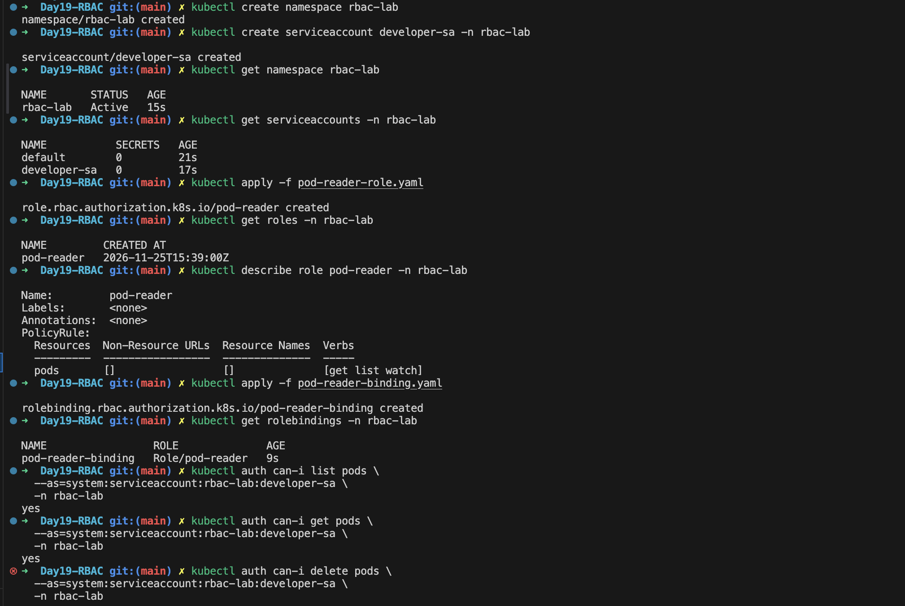
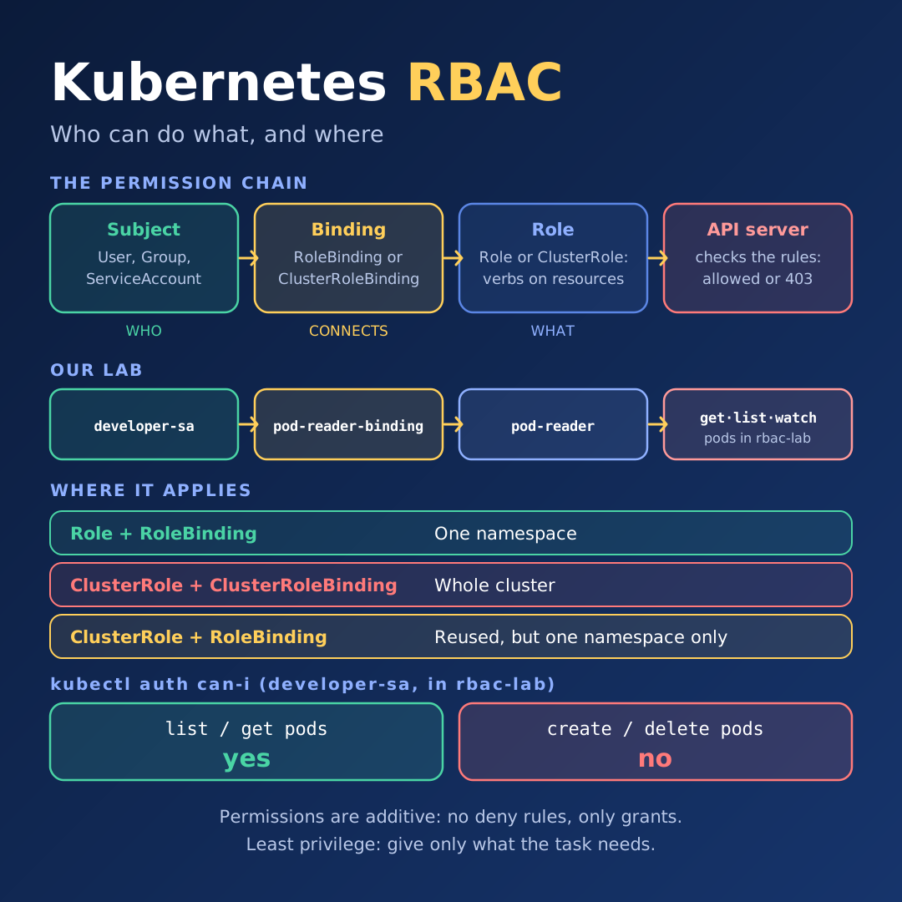

# Day 19: Kubernetes RBAC (Role-Based Access Control)


## 1. What is RBAC in Kubernetes?

**RBAC (Role-Based Access Control)** is the Kubernetes authorization mechanism that controls **what actions users, groups and Service Accounts can perform on Kubernetes resources**.

Example: a production cluster with three kinds of identities:

| Identity | Needs |
|---|---|
| **Administrator** | Manage cluster resources |
| **Developer** | View and update application resources in a specific namespace |
| **Monitoring application** | Read Pods and Services to collect information |

Giving everyone full cluster access creates unnecessary security risk. RBAC lets you grant each identity **only the permissions it needs**.

### The four RBAC objects

| Object | Scope | Purpose |
|---|---|---|
| **Role** | One namespace | Defines permissions within a namespace |
| **ClusterRole** | Cluster-wide | Defines permissions for cluster-scoped resources (like Nodes), or for namespaced resources across namespaces |
| **RoleBinding** | One namespace | Grants a Role or ClusterRole to subjects **within that namespace** |
| **ClusterRoleBinding** | Cluster-wide | Grants a ClusterRole to subjects **across the whole cluster** |

---

## 2. Why do we need RBAC?

Without proper access control, a developer might accidentally delete production workloads, change sensitive resources, or read information they don't need.

RBAC supports the **principle of least privilege**: grant only the minimum permissions required for a task.

Real-world use cases:

- Restricting developers to their own namespaces.
- Letting CI/CD pipelines deploy applications without `cluster-admin`.
- Giving monitoring agents read-only access to selected resources.
- Preventing application workloads from modifying Kubernetes infrastructure.
- Separating development, testing and production permissions.

### How it connects to Day 18

| Topic | Role |
|---|---|
| **Service Account** (Day 18) | Identifies the workload (**who**) |
| **RBAC** (Day 19) | Defines which API operations that identity can perform (**what**) |

Authentication establishes the identity. RBAC decides whether that identity is **allowed** to perform the requested operation.

---

## 3. How RBAC works under the hood

### 3.1 The request path

Every request to the API server goes through three stages:

```
Request (kubectl, Pod using a token, CI tool)
   │
   ▼
1. Authentication   Who is this?        (certificate, OIDC token, Service Account token)
   │
   ▼
2. Authorization    Is this allowed?    ← RBAC makes this decision
   │
   ▼
3. Admission        Policy checks and defaults
   │
   ▼
Request is stored / executed
```

- Failing authentication returns **401 Unauthorized**.
- Failing authorization returns **403 Forbidden**.

### 3.2 What the RBAC authorizer checks

For each request, the API server builds a set of attributes:

| Attribute | Example |
|---|---|
| **User and groups** | `system:serviceaccount:rbac-lab:developer-sa` |
| **Verb** | `list` |
| **Resource** (and API group) | `pods` in the core group (`""`) |
| **Namespace** | `rbac-lab` |
| **Resource name** (optional) | a specific Pod |

The authorizer then:

1. Finds every **binding** that has this user or group as a subject.
2. Follows each binding to its **Role or ClusterRole**.
3. Checks whether **any rule** in those roles matches the verb, resource, API group (and namespace).
4. **Allows** the request if a match is found. Otherwise it is not allowed by RBAC (and is rejected with 403 if no other authorizer allows it).

### 3.3 The chain of objects

```
Subject  ──►  Binding  ──►  Role  ──►  Rules (verbs on resources)
(who)       (connects)    (what)
```

In this lab:

```
developer-sa  ──►  pod-reader-binding  ──►  pod-reader  ──►  get, list, watch on pods in rbac-lab
```

A **Role** alone grants nothing. Permissions only exist after a **binding** connects the Role to a subject.

### 3.4 What a rule contains

| Field | Meaning | Example |
|---|---|---|
| **apiGroups** | Which API group the resource belongs to | `""` (core group: Pods, Services, ConfigMaps) or `apps` (Deployments) |
| **resources** | Which resource types | `pods`, `deployments` |
| **verbs** | Which operations | `get`, `list`, `watch` |
| **resourceNames** (optional) | Limit to specific named objects | one named ConfigMap |

Subresources are separate resources: `pods/log` and `pods/exec` need their own rules. Permission on `pods` does not include them.

### 3.5 Subjects: who can be granted access

| Subject kind | Example |
|---|---|
| **User** | A person from your identity system (certificate, OIDC) |
| **Group** | A group of users |
| **ServiceAccount** | A workload identity such as `developer-sa` |

Kubernetes has no `User` object. User and group names come from the authentication method.

---

## 4. Role vs ClusterRole, RoleBinding vs ClusterRoleBinding

### Role vs ClusterRole

- A **Role** is namespaced and defines permissions for resources **in that namespace**.
- A **ClusterRole** can define permissions for **cluster-scoped resources** (such as Nodes), or for namespaced resources **across all namespaces** when used with a ClusterRoleBinding. A ClusterRole can also be **reused** through RoleBindings in individual namespaces.

### RoleBinding vs ClusterRoleBinding

- A **RoleBinding** grants permissions **within one namespace**. Even when it references a ClusterRole, the grant is **limited to the RoleBinding's namespace**.
- A **ClusterRoleBinding** grants the ClusterRole's permissions **cluster-wide**.

### The three combinations

| Combination | Result |
|---|---|
| Role + RoleBinding | Permissions in **one namespace** |
| ClusterRole + ClusterRoleBinding | Permissions **across the cluster** |
| ClusterRole + RoleBinding | A reusable permission set, applied in **only one namespace** |

> **Important:** RBAC permissions are **additive**. There are **no deny rules**. An identity's effective access is the combination of every applicable binding and any other configured authorization mechanism.

### Built-in ClusterRoles worth knowing

| ClusterRole | Typical meaning |
|---|---|
| `cluster-admin` | Full control of everything |
| `admin` | Full control within a namespace (when bound with a RoleBinding) |
| `edit` | Read and write most namespaced resources |
| `view` | Read-only access to most namespaced resources |

Prefer reusing `view` or `edit` through a RoleBinding over inventing broad custom roles.

---

## 5. Lab files

This lab uses the manifests already in this folder, so they are not repeated here:

| File | Purpose |
|---|---|
| `pod-reader-role.yaml` | Role `pod-reader` in `rbac-lab`: read-only access to Pods |
| `pod-reader-binding.yaml` | RoleBinding `pod-reader-binding`: grants `pod-reader` to `developer-sa` |

---

## 6. Lab 1: Create the environment

```bash
kubectl create namespace rbac-lab
kubectl create serviceaccount developer-sa -n rbac-lab
kubectl get namespace rbac-lab
kubectl get serviceaccounts -n rbac-lab
```

Expected:

```
NAME           SECRETS   AGE
default        0         ...
developer-sa   0         ...
```

The output varies by version. Modern clusters use projected tokens and don't create a permanent token Secret for each Service Account.

---

## 7. Lab 2: Create a Role to read Pods

Scenario: a developer should be able to **view** Pods in `rbac-lab`, but not create or delete them.

```bash
kubectl apply -f pod-reader-role.yaml
kubectl get roles -n rbac-lab
kubectl describe role pod-reader -n rbac-lab
```

The Role defines the permissions, but it does **not** grant them to anyone yet.

> Creating a Role alone does not give a user or Service Account those permissions. You must **bind** it to an identity.

---

## 8. Lab 3: Bind the Role to the Service Account

```bash
kubectl apply -f pod-reader-binding.yaml
kubectl get rolebindings -n rbac-lab
kubectl describe rolebinding pod-reader-binding -n rbac-lab
```

The permission flow is:

```
developer-sa  →  pod-reader-binding  →  pod-reader  →  read Pods in rbac-lab
```

> **Note:** a binding's `roleRef` (which Role it points to) **cannot be changed** after creation. To point a binding at a different Role, delete and recreate it.

---

## 9. Lab 4: Test RBAC permissions

```bash
# Can list Pods?
kubectl auth can-i list pods \
  --as=system:serviceaccount:rbac-lab:developer-sa -n rbac-lab
# yes

# Can get Pods?
kubectl auth can-i get pods \
  --as=system:serviceaccount:rbac-lab:developer-sa -n rbac-lab
# yes

# Can delete Pods?
kubectl auth can-i delete pods \
  --as=system:serviceaccount:rbac-lab:developer-sa -n rbac-lab
# no

# Can create Pods?
kubectl auth can-i create pods \
  --as=system:serviceaccount:rbac-lab:developer-sa -n rbac-lab
# no
```

See everything the identity can do in the namespace:

```bash
kubectl auth can-i --list \
  --as=system:serviceaccount:rbac-lab:developer-sa -n rbac-lab
```

Also test the boundary: the permission is limited to `rbac-lab`.

```bash
kubectl auth can-i list pods \
  --as=system:serviceaccount:rbac-lab:developer-sa -n default
# no
```



Notes:

- Your own account must be allowed to **impersonate** the Service Account, otherwise you get an authorization error.
- `kubectl auth can-i` checks **authorization only**. A request can still fail because of admission policies or validation.

---

## 10. RBAC verbs

| Verb | Meaning |
|---|---|
| `get` | Retrieve one resource |
| `list` | List resources |
| `watch` | Observe changes to resources |
| `create` | Create resources |
| `update` | Replace or update a resource |
| `patch` | Apply a partial update |
| `delete` | Delete one resource |
| `deletecollection` | Delete a collection of resources, where supported |

A read-only monitoring role typically uses `get`, `list` and `watch`.

A deployment pipeline may need more, but choose verbs based on its **actual responsibilities**.

> **Avoid wildcards.** Using `*` for verbs and resources can grant far broader access than intended. Use it only with a clearly justified requirement.

---

## 11. Best practices

- Follow **least privilege**: start with nothing and add only what's needed.
- Prefer **namespaced** Roles and RoleBindings over ClusterRoles and ClusterRoleBindings.
- Avoid wildcards for verbs, resources and API groups.
- Don't bind `cluster-admin` to applications or to ordinary users.
- Use **dedicated Service Accounts** per application (Day 18) and bind permissions to those.
- Remember that permission to **read Secrets** or to **create Pods** can effectively lead to broader access, so grant them carefully.
- Review bindings regularly: `kubectl get rolebindings,clusterrolebindings -A`.

---

## 12. Common issues

| Symptom | Likely cause |
|---|---|
| `403 Forbidden` (`cannot list resource "pods" in API group "" in the namespace ...`) | No Role and binding grants that verb on that resource in that namespace |
| `can-i` says `no` after creating a Role | The Role isn't bound yet, or the binding's subject is wrong |
| Binding exists but has no effect | Wrong Service Account **namespace** in the subject, or wrong namespace on the binding |
| Works in one namespace but not another | A RoleBinding only applies in its own namespace |
| `can-i` shows an impersonation error | Your own user isn't allowed to impersonate Service Accounts |
| Can read `pods` but not `pods/log` | Subresources need their own rule |
| Deployments permission doesn't work | Wrong `apiGroups` (Deployments are in `apps`, not the core group) |
| Can't edit a binding's Role | `roleRef` is immutable. Delete and recreate the binding. |

---

## 13. Cleanup

```bash
kubectl delete namespace rbac-lab
```

This removes the Service Account, Role and RoleBinding created in the namespace.

---

## 14. Interview questions

**1. What is RBAC?**
The Kubernetes authorization mechanism that controls which actions an identity can perform on which resources.

**2. What are the four RBAC objects?**
Role, ClusterRole, RoleBinding and ClusterRoleBinding.

**3. Role vs ClusterRole?**
A Role is namespaced. A ClusterRole can cover cluster-scoped resources or be applied across namespaces, and can be reused through RoleBindings.

**4. What happens if a RoleBinding references a ClusterRole?**
The permissions apply only in the RoleBinding's namespace.

**5. Does RBAC support deny rules?**
No. Permissions are additive, and access is the union of all applicable grants.

**6. Authentication vs authorization?**
Authentication establishes who you are (401 on failure). Authorization decides what you may do (403 on failure). RBAC is authorization.

**7. Does creating a Role grant permissions?**
No. It must be bound to a subject with a RoleBinding or ClusterRoleBinding.

**8. How do you check what a Service Account can do?**
`kubectl auth can-i <verb> <resource> --as=system:serviceaccount:<ns>:<name> -n <ns>`, or add `--list`.

**9. Why avoid wildcards in RBAC rules?**
They can grant much broader access than intended and break least privilege.

**10. How do Service Accounts relate to RBAC?**
A Service Account is the identity of a workload. RBAC defines what that identity can do.

---

## 15. CKA tips

Imperative commands are faster than writing YAML in the exam:

```bash
kubectl create role pod-reader --verb=get,list,watch --resource=pods -n rbac-lab

kubectl create rolebinding pod-reader-binding \
  --role=pod-reader \
  --serviceaccount=rbac-lab:developer-sa \
  -n rbac-lab

kubectl create clusterrole node-reader --verb=get,list,watch --resource=nodes

kubectl create clusterrolebinding node-reader-binding \
  --clusterrole=node-reader \
  --serviceaccount=rbac-lab:developer-sa
```

Remember the Service Account format in a binding is `<namespace>:<name>`. Verify with `kubectl auth can-i` every time.

---

## 16. Key takeaways

- **RBAC** controls what an authenticated identity is allowed to do.
- Four objects: **Role, ClusterRole, RoleBinding, ClusterRoleBinding**.
- A Role defines permissions. A **binding** gives them to a subject.
- A RoleBinding limits a grant to **one namespace**, even when it references a ClusterRole.
- Permissions are **additive**. There are no deny rules.
- **Service Account = who. RBAC = what.**
- Use **least privilege**, prefer namespaced roles, and avoid wildcards and `cluster-admin`.
- `kubectl auth can-i --as=system:serviceaccount:<ns>:<name>` shows what an identity can do.

